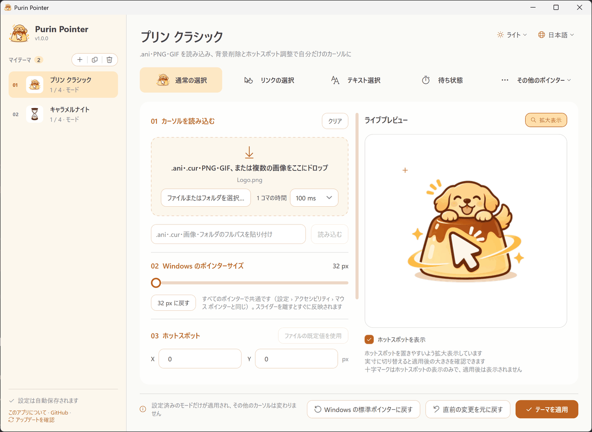

<p align="center">
  
</p>

<h1 align="center">Purin Pointer</h1>

<p align="center">
  <b>Windows のためのアニメーションカーソル工房</b><br>
  画像や GIF、カーソルファイルから、自分だけの Windows マウスポインターを作れます。
</p>

<p align="center">
  <a href="README.md">English</a> · <a href="README.tw.md">繁體中文</a> · <a href="README.zh-Hans.md">简体中文</a> · <b>日本語</b> · <a href="README.ko.md">한국어</a>
</p>

---

Purin Pointer は AniOnMac の Windows 版です。`.ani`、`.cur`、PNG、GIF、または画像のフォルダを読み込み、ワンクリックで背景を削除し、ホットスポットを配置して、Windows のポインターとして適用できます。絵を描く技術も管理者権限も必要ありません。



## 主な機能

- **テーマ**：いくつでも作成でき、サイドバーで追加・複製・削除できます。適用中のテーマには *使用中* のタグが付き、すべて自動で保存されます。
- **4 つのモードと 13 種類のポインター**：通常の選択、リンクの選択、テキスト選択、待ち状態に加え、*バックグラウンドで作業中* を含む Windows のその他 13 種類のポインターを *その他のポインター* から設定できます（*バックグラウンドで作業中* は個別に設定するまで待ち状態と同じカーソルを使います）。適用されるのは設定済みのモードだけです。
- **さまざまな素材に対応**：`.ani`、`.cur`、`.ico`、PNG、JPG、BMP、アニメーション GIF、または番号付き画像のフォルダ。
- **タイムライン**：コマの並べ替えや削除、1 コマの時間の設定ができ、その場でプレビューできます。
- **背景の削除**：単色の背景には *自動で削除*、全コマ共通の 1 色を消すには *自動選択ツール* を使います。
- **ホットスポット**：拡大プレビュー上でドラッグするか、X / Y を入力します。
- **ホットスポットの補正**：自分のカーソルで 5 つの点を順にクリックすると、先端のずれを測ってホットスポットを自動で補正します。あとは適用するだけです。
- **描画スタイル**：モードごとに *高解像度*（なめらかな輪郭）、*ドット絵*（ドットが見える）、*ギザギザ*（昔のカーソルのような硬い輪郭）から選べます。プレビューには Windows が実際に描く見た目が表示されます。
- **ポインターのサイズ**：Windows の設定と同じ全体共通のサイズ（32〜256 px）で、常に同期されます。
- **元に戻す**：*直前の変更を元に戻す* と *Windows の標準ポインターに戻す* がワンクリックで使えます。
- **ライトとダーク**：プリンをイメージした配色で、繁體中文、简体中文、English、日本語、한국어 に対応しています。

## ダウンロード

1. [Releases](https://github.com/Yucheng0208/Purin-Pointer/releases/latest) から ZIP をダウンロードします。
   - `PurinPointer-win-x64.zip`：ほとんどの Windows PC（Intel / AMD）
   - `PurinPointer-win-arm64.zip`：ARM ノート PC（Snapdragon など）
2. 展開して `PurinPointer.exe` を実行します。インストールも .NET の別途インストールも不要です。
3. **Windows によって PC が保護されました** と表示された場合は、**詳細情報 → 実行** をクリックします。

> [!IMPORTANT]
> リリース版は **コード署名されていません**。**スマート アプリ コントロール** がオンになっていると、Windows 11 は署名のないアプリを一律にブロックします。その場合は [ソースからビルド](docs/engineering.ja.md#build-and-run) してください。

Windows 10 または Windows 11 が必要です。

## クイックスタート

1. モードのタブを選びます（例：**通常の選択**）。
2. 画像、GIF、または `.ani` ファイルを **01 カーソルを読み込む** にドラッグします。
3. 背景がある場合は、**04 背景を削除** の **自動で削除** をクリックします。
4. プレビュー上のホットスポットの十字を、ポインターの先端までドラッグします。
5. **テーマを適用** をクリックします（または **Ctrl + Enter** を押します）。

詳しい手順は [ユーザーガイド](docs/user-guide.ja.md) をご覧ください。

## ドキュメント

| ドキュメント | 内容 |
| --- | --- |
| [ユーザーガイド](docs/user-guide.ja.md) | すべての画面と機能の手順、トラブルシューティング |
| [エンジニアリングガイド](docs/engineering.ja.md) | アーキテクチャ、ビルド、テスト、Windows との連携、リリース手順 |

## ソースからビルド

[.NET 10 SDK](https://dotnet.microsoft.com/download) が必要です。

```powershell
dotnet run --project src/PurinPointer
```

```powershell
dotnet run --project tests/PurinPointer.Tests
```

発行方法やプロジェクト構成については [エンジニアリングガイド](docs/engineering.ja.md) をご覧ください。

## ライセンス

[GPL-3.0](LICENSE)
