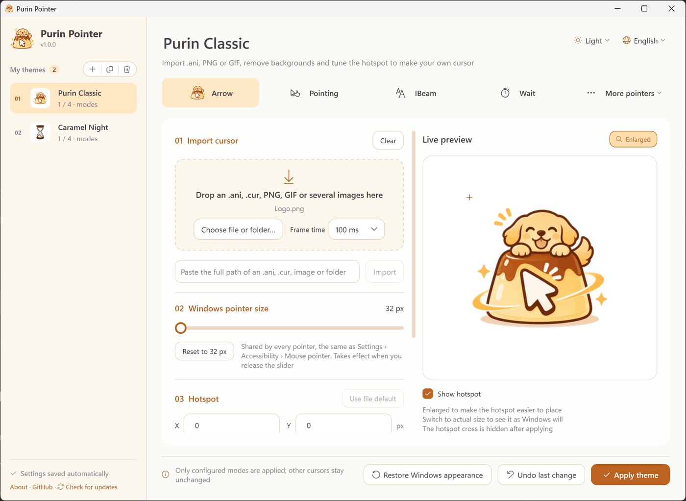

<p align="center">
  
</p>

<h1 align="center">Purin Pointer</h1>

<p align="center">
  <b>Animated cursor studio for Windows</b><br>
  Turn images, GIFs and cursor files into your own Windows mouse pointers.
</p>

<p align="center">
  <b>English</b> · <a href="README.tw.md">繁體中文</a> · <a href="README.zh-Hans.md">简体中文</a> · <a href="README.ja.md">日本語</a> · <a href="README.ko.md">한국어</a>
</p>

---

Purin Pointer is the Windows edition of AniOnMac. Import `.ani`, `.cur`, PNG, GIF or a folder of images, remove the background in one click, place the hotspot, and apply it as your Windows pointer. No drawing skills, no administrator rights.



## Features

- **Themes**: as many as you like, with add, duplicate and delete in the sidebar. The applied theme is tagged *In use*, and everything saves automatically.
- **4 modes plus 13 pointers**: Arrow, Pointing, IBeam and Wait, plus the other 13 Windows pointers under *More pointers*, including *Working in Background* (it follows Wait until you give it its own cursor). Only filled modes are applied.
- **Any source**: `.ani`, `.cur`, `.ico`, PNG, JPG, BMP, animated GIF, or a folder of numbered images.
- **Timeline**: order frames, remove frames, set the frame time and preview live.
- **Background removal**: *Auto remove* for flat backgrounds, the *Magic wand* for one colour across every frame.
- **Hotspot**: drag it on an enlarged preview, or type X / Y.
- **Hotspot calibration**: click five dots with your own cursor; Purin Pointer measures how far off the tip is and corrects the hotspot, ready to apply.
- **Drawing style**: per mode, choose *High-res* (smooth edges), *Pixel* (visible square pixels) or *Jagged* (hard edges like classic pointers). The preview shows exactly what Windows will draw.
- **Pointer size**: the same global size as Windows Settings (32–256 px), kept in sync.
- **Undo**: *Undo last change* and *Restore Windows appearance* are one click away.
- **Light and dark**: pudding-coloured themes, in 繁體中文, 简体中文, English, 日本語 and 한국어.

## Download

1. Download a ZIP from [Releases](https://github.com/Yucheng0208/Purin-Pointer/releases/latest):
   - `PurinPointer-win-x64.zip`: most Windows PCs (Intel / AMD)
   - `PurinPointer-win-arm64.zip`: ARM laptops (such as Snapdragon)
2. Extract it and run `PurinPointer.exe`. No installation and no separate .NET install needed.
3. If **Windows protected your PC** appears, click **More info → Run anyway**.

> [!IMPORTANT]
> Releases are **not code-signed**. With **Smart App Control** turned on, Windows 11 blocks unsigned apps outright. In that case, [build from source](docs/engineering.md#build-and-run).

Requires Windows 10 or Windows 11.

## Quick start

1. Pick a mode tab, for example **Arrow**.
2. Drag an image, GIF or `.ani` file onto **01 Import cursor**.
3. If it has a background, click **Auto remove** under **04 Remove background**.
4. Drag the hotspot cross on the preview to the tip of your pointer.
5. Click **Apply theme** (or press **Ctrl + Enter**).

The full walkthrough is in the [user guide](docs/user-guide.md).

## Documentation

| Document | For |
| --- | --- |
| [User guide](docs/user-guide.md) | Every screen and feature, step by step, with troubleshooting |
| [Engineering guide](docs/engineering.md) | Architecture, building, testing, Windows integration and releasing |

## Build from source

Requires the [.NET 10 SDK](https://dotnet.microsoft.com/download).

```powershell
dotnet run --project src/PurinPointer
```

```powershell
dotnet run --project tests/PurinPointer.Tests
```

See the [engineering guide](docs/engineering.md) for publishing and the project layout.

## License

[GPL-3.0](LICENSE)
