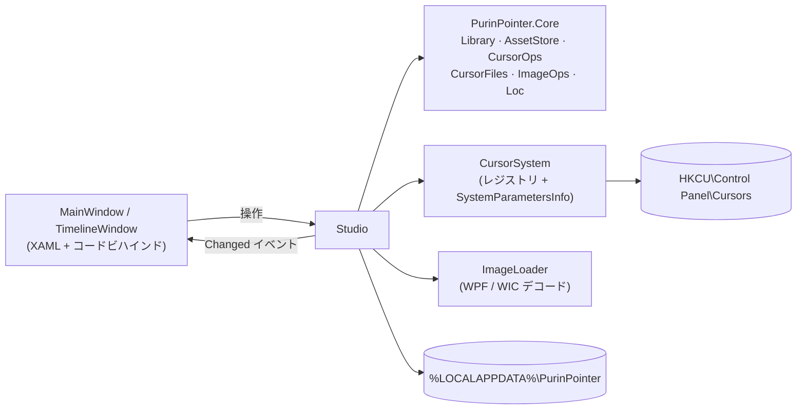
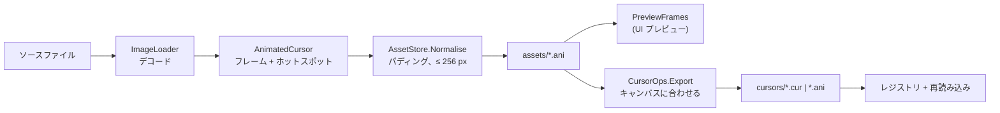

# Purin Pointer エンジニアリングガイド

[English](engineering.md) · [繁體中文](engineering.tw.md) · **日本語** · [한국어](engineering.ko.md)

Purin Pointer の構成、Windows とのやり取りの仕組み、そしてビルド・テスト・リリースの方法を説明します。

## 目次

1. [概要](#1-概要)
2. [リポジトリ構成](#2-リポジトリ構成)
3. [ビルドと実行](#build-and-run)
4. [アーキテクチャ](#4-アーキテクチャ)
5. [データモデルと保存先](#5-データモデルと保存先)
6. [カーソル処理パイプライン](#6-カーソル処理パイプライン)
7. [Windows との連携](#7-windows-との連携)
8. [ユーザーインターフェイス](#8-ユーザーインターフェイス)
9. [ローカライズ](#9-ローカライズ)
10. [テスト](#10-テスト)
11. [リリース手順](#11-リリース手順)
12. [既知の制限事項](#12-既知の制限事項)

---

## 1. 概要

| | |
| --- | --- |
| 言語 / ランタイム | C#（最新）、.NET 10 |
| UI | WPF（`net10.0-windows`）、モニターごとの DPI 対応（PerMonitorV2） |
| プラットフォーム | Windows 10 / 11、x64 および ARM64 |
| 依存関係 | .NET SDK 以外になし（NuGet パッケージなし） |
| 権限 | 起動したユーザーの権限で実行され、UAC のプロンプトは表示されない（`asInvoker`） |
| ライセンス | GPL-3.0 |

## 2. リポジトリ構成

```text
PurinPointer.sln
Directory.Build.props          Version, nullable, implicit usings for every project
src/
  PurinPointer.Core/           Platform-neutral logic (net10.0, no WPF / Win32)
    Bitmap32.cs                BGRA image buffer and CursorFrame
    CursorFiles.cs             .cur / .ico / .ani readers and writers
    CursorRole.cs              The 17 Windows pointers and their registry names
    ImageOps.cs                Resampling, GIF composition, background removal, natural sort
    Library.cs                 Themes (Library, Profile, Slot), AssetStore, CursorOps
    Localization.cs            Loc: embedded string tables and language detection
    Versions.cs                Version comparison for the update check
    Strings/*.json             UI strings: en, zh-Hant, zh-Hans, ja, ko
  PurinPointer/                The WPF app (net10.0-windows)
    App.xaml(.cs)              Global styles, unhandled-error handler
    MainWindow.xaml(.cs)       Main window layout and event handlers
    TimelineWindow.xaml(.cs)   Frame ordering dialog
    Studio.cs                  App state and actions (the "view model")
    CursorSystem.cs            Registry, SystemParametersInfo, snapshots
    ImageLoader.cs             WPF/WIC image decoding, GIF frames, PreviewFrames
    AnimatedImage.cs           Image control that plays PreviewFrames
    ThemeManager.cs            Light/dark dictionaries, dark title bar, CJK font selection
    UpdateChecker.cs           GitHub latest-release check
    Themes/Light.xaml, Dark.xaml   Colour palettes
    Assets/                    App icon (.ico) and sidebar logo
    app.manifest               asInvoker, PerMonitorV2
tests/
  PurinPointer.Tests/          Dependency-free test runner for PurinPointer.Core
docs/                          This guide, the user guide, screenshots
```

`PurinPointer.Core` は意図的に Windows に依存しない作りになっているため、どの OS でもビルドでき、テストも実行できます。WPF、WIC、レジストリに関わる処理はすべて `src/PurinPointer` にあります。

<a id="build-and-run"></a>
## 3. ビルドと実行

**必要なもの**：[.NET 10 SDK](https://dotnet.microsoft.com/download)、または *.NET デスクトップ開発* ワークロードを含む Visual Studio 2026。アプリは Windows でのみ動作しますが、ソリューションは macOS や Linux でもビルドでき（`EnableWindowsTargeting`）、CI に便利です。

**Visual Studio**：`PurinPointer.sln` を開き、`PurinPointer` をスタートアップ プロジェクトに設定して **F5** を押します。

**コマンドライン**（リポジトリのルートから）：

アプリを実行する：

```powershell
dotnet run --project src/PurinPointer
```

テストを実行する（どの OS でも可）：

```powershell
dotnet run --project tests/PurinPointer.Tests
```

単一ファイルのリリース用 `.exe` をビルドする（ARM の場合は `-r win-arm64` を使用）：

```powershell
dotnet publish src/PurinPointer -c Release -r win-x64 --self-contained -p:PublishSingleFile=true -p:IncludeNativeLibrariesForSelfExtract=true -o publish\win-x64
```

生成される `publish\win-x64\PurinPointer.exe` には .NET ランタイムが含まれているため、.NET がインストールされていない PC でも動作します。リリースビルドには `.pdb` は含まれません（`Directory.Build.props` の `DebugType=none`）。

> [!NOTE]
> スマート アプリ コントロールがオンの場合、ビルドしたばかりの署名のない `PurinPointer.dll` が Windows にブロックされることがあります（"An Application Control policy has blocked this file"）。判定はファイルごとに行われるため、Debug ビルドがブロックされても Release ビルドは実行できる、あるいはその逆の場合があります。一方の構成がブロックされたら、もう一方を試してください。

## 4. アーキテクチャ



- **`Studio`** はすべての状態（ライブラリ、選択中のモード、処理中フラグ、ステータスメッセージ）を保持し、あらゆる操作を実行します。変更のたびに `Changed` を発生させます。
- **`MainWindow`** は表示上の詳細（ズーム、ドラッグ中かどうか）以外に独自の状態を持ちません。`Changed` のたびに、`Refresh()` が `Studio` からすべてを再描画します。サイドバーは内容のシグネチャが変わったときにだけ再構築されるため、サムネールのアニメーションは途切れません。
- 時間のかかる処理（デコード、ファイルの書き込み、適用）は `Studio.Run` を通して実行されます。`Studio.Run` は `Busy` を設定してオーバーレイを表示し、例外は `Failed` イベント経由でダイアログとして通知します。
- 処理されなかった例外は `App.OnUnhandledException` に届き、`error.log` を書き出してから、クラッシュする代わりにダイアログを表示します。

## 5. データモデルと保存先

```text
Library
├─ Profiles: List<Profile>         one per theme
│   └─ Slots: List<Slot>           one per mode: arrow, pointing, text, wait + 12 extra
│       ├─ Asset                   "assets/<guid>.ani" (empty = not set)
│       ├─ Filename                shown under the drop area
│       ├─ Hotspot                 [x, y] as a fraction of the image, or null = file's own
│       └─ OriginalAsset           asset before background removal
├─ Selected, InUse                 theme ids
├─ UndoProfiles                    per theme: the profile before its last edit/apply
├─ AppliedProfiles                 per theme: the profile as last applied
├─ BackupsByTheme                  per theme: "backups/<id>.json" pointer snapshot
└─ Language, Appearance
```

すべてのデータは `%LOCALAPPDATA%\PurinPointer\` に保存されます。

| パス | 書き込み元 | 内容 |
| --- | --- | --- |
| `library.json` | 変更のたびに `Studio.Save` | 上記の `Library` をインデント付き JSON で保存したもの。`.tmp` に書き込んでから移動するため、クラッシュしても書きかけのファイルが残ることはありません。 |
| `assets\*.ani` | `AssetStore.Save` | 読み込んだすべてのカーソルを正規化したもの（後述）。参照されなくなったファイルは `AssetStore.CollectGarbage` が削除します。 |
| `cursors\*.cur, *.ani` | `CursorSystem.StoreCursorFile` | Windows が実際に読み込むファイル。レジストリからもスナップショットからも参照されていないファイルは `CursorSystem.CleanUpFiles` が削除します。 |
| `backups\<theme>.json` | `Studio.Apply` | そのテーマを適用する直前のポインター設定の `CursorSnapshot`。 |
| `native-reset-recovery.json` | `Studio.RestoreNative` | 最後に *Windows の標準ポインターに戻す* を行う前のスナップショット。 |
| `error.log` | `App.OnUnhandledException` | 例外の詳細情報すべて。 |

**ホットスポットは画像に対する割合**（0〜1）**で保存される** ため、カーソルをどのサイズで書き出しても正しい位置に保たれます。

**モードと Windows ポインターの対応**（`CursorModes.Roles`）：

| スロットのキー | レジストリ値 |
| --- | --- |
| `arrow` | `Arrow` |
| `pointing` | `Hand` |
| `text` | `IBeam` |
| `wait` | `Wait` と `AppStarting` |
| `Help`、`Crosshair`、`NWPen`、`No`、`SizeNS`、`SizeWE`、`SizeNWSE`、`SizeNESW`、`SizeAll`、`UpArrow`、`Pin`、`Person` | 同じ名前の値 |

## 6. カーソル処理パイプライン



1. **デコード**（`ImageLoader`）。`.ani` は `AniReader`、`.cur`/`.ico` は `IconReader` で読み込みます。どちらも PNG 圧縮されたフレームには WPF のデコーダーを使います。画像は WPF/WIC を使うため、Windows にインストールされているコーデックであれば何でも扱えます。アニメーション GIF は `GifComposer` がオフセットと破棄モードに従ってフレームごとに合成します。フォルダは展開され、`NaturalStringComparer` で並べ替えられます。
2. **正規化**（`AssetStore.Normalise`）。サイズの異なるフレームは 1 つのサイズにパディングされ、256 px を超えるものは縮小されます（`Resampler.Resize`、乗算済みアルファでの面積平均法）。ホットスポットもそれに合わせて縮尺されます。結果は `.ani` として `assets\` に保存されます。
3. **編集**。背景の削除（`CursorOps.Knockout`）はすべてのフレームに対して実行され、新しいアセットを書き出し、以前のアセットは `OriginalAsset` に保持されます。自動選択ツールは起点の色を一度だけ取得し、すべてのフレームで同じ位置から塗りつぶします。縁からの削除では、境界で最も多い色を見つけ、境界のすべてのピクセルから塗りつぶします。
4. **書き出し**（`CursorOps.Export`）。各フレームは、`CanvasFor(baseSize)` = ポインターサイズの 2 倍（64〜256 px に制限）の正方形キャンバスに、中央揃えで収まるよう配置されます。ホットスポットはそのキャンバス上の位置に変換されます。フレームが 1 つなら `.cur`（`CurWriter`、AND マスク付きの 32 ビット DIB）、複数なら `.ani`（`AniWriter`、フレームごとの `rate` を 1/60 秒単位の jiffy で持つ RIFF `ACON`）になります。

形式に関するコードはすべて `CursorFiles.cs` にあり、往復変換のテストが行われています。

## 7. Windows との連携

すべてユーザー単位で、`HKEY_CURRENT_USER\Control Panel\Cursors` の下で行われます。これはマウスのコントロール パネルが書き込むのと同じキーです。管理者権限は必要ありません。

### テーマの適用（`Studio.Apply`）

1. 先にすべてのカーソルファイルを作成し、壊れたアセットがあれば Windows に触れる前に失敗させます。
2. 現在の値の `CursorSnapshot` を `backups\<theme>.json` に保存します。
3. `CursorSystem.ApplyRoles` が設定済みのロールだけを書き込み、その他はそのまま残し、配色名を `Purin Pointer`（`Scheme Source` = 1）に設定します。さらに `Control Panel\Cursors\Schemes` の下にも登録するため、従来の「マウスのプロパティ」ダイアログにも表示されます。
4. 再読み込み（後述）を行い、テーマを `InUse` としてマークし、`cursors\` 内の参照されていないファイルを削除します。

### 再読み込みとポインターのサイズ

`CursorSystem.Reload` は、次の順序で呼び出しを行います。

| 呼び出し | 目的 |
| --- | --- |
| `SystemParametersInfo(0x2029 /* SPI_SETCURSORBASESIZE */, 0, size, SPIF_UPDATEINIFILE \| SPIF_SENDCHANGE)` | 「設定 › アクセシビリティ」と同じ方法でポインターのサイズを設定します。非公開ですが安定しています。これを呼ばないと、Windows はメモリ上の古いサイズを保持し続け、それを `CursorBaseSize` に書き戻してしまうことがあります。 |
| `SystemParametersInfo(SPI_SETCURSORS, 0, NULL, SPIF_UPDATEINIFILE \| SPIF_SENDCHANGE)` | レジストリからカーソルを再読み込みし、実行中のアプリに通知します。 |

> [!IMPORTANT]
> `SPI_SETCURSORS` は、多くの Windows 10/11 のビルドで、再読み込み自体は成功していても **FALSE とエラー 0** を返します。そのため戻り値は意図的に無視しています。これを失敗として扱っていたことが、1.0 で修正された "Windows refused to reload the cursors (error 0)" という不具合の原因でした。

サイズは `SPI_GETCURSORBASESIZE`（0x2028）で読み戻し、取得できない場合は `CursorBaseSize` レジストリ値を使います。`HKCU\Software\Microsoft\Accessibility\CursorSize`（1〜15。1 = 32 px で、1 段階ごとに 16 px 増加）も更新するため、設定のスライダーにも同じ値が表示されます。

### 元に戻す操作と復元

- **直前の変更を元に戻す**（`Studio.Restore`）は、`CursorSystem.Restore` でテーマのバックアップのスナップショットを書き戻し、テーマを `UndoProfiles` のエントリと入れ替えます。
- **Windows の標準ポインターに戻す**（`Studio.RestoreNative`）は、現在の値を `native-reset-recovery.json` に保存してから、`HKLM\…\Control Panel\Cursors\Schemes` の *Windows Default* 配色を（見つからない場合は標準の `aero_*` ファイルを）サイズ 32 で書き込みます。

### 「使用中」の表示を正確に保つ

起動時に `Studio.Load` は、`CursorSystem.UsesAppCursors()` が `cursors\` 内の既存ファイルを指すレジストリ値を見つけない限り、`InUse` をクリアします。これにより、アプリを閉じている間にユーザーが Windows の設定でポインターを変更した場合にも対応できます。

## 8. ユーザーインターフェイス

- **スタイル** は `App.xaml` にあります。角丸のボタン、トグルボタン、テキストボックス、コンボボックス、スライダー、細い縦横のスクロールバー、メニュー、チェックボックスです。色はすべて `DynamicResource` のキーです。
- **テーマ**（`ThemeManager.Apply`）は、マージされたディクショナリの 0 番目を `Themes/Light.xaml` と `Themes/Dark.xaml` の間で切り替えます。*システム* モードでは `AppsUseLightTheme` を読み取り、`SystemEvents.UserPreferenceChanged` を監視します。タイトルバーは `DwmSetWindowAttribute(DWMWA_USE_IMMERSIVE_DARK_MODE)` によって追従します。
- **フォント**（`ThemeManager.ApplyFont`）は、`UiFont` リソースを Segoe UI と、選択中の言語の CJK フォント（JhengHei、YaHei、Yu Gothic、Malgun Gothic のいずれか）の順に設定します。WPF は各文字を、一覧の中でその文字を持つ最初のフォントから描画するため、一覧を固定にすると日本語が中国語フォントで描画されてしまいます。
- **アニメーション** には `AnimatedImage` を使います。これは `DispatcherTimer` で `PreviewFrames` を順に切り替える `Image` です。
- **レイアウト**：設定列は単独でスクロールし、プレビュー列の枠はウィンドウに合わせて大きくなります。起動時にウィンドウのサイズを作業領域内に制限するため、拡大率 175 % のノート PC でも収まります。
- **キーボード**：Ctrl + Enter でテーマを適用します。Enter でパスのボックスとホットスポットの X / Y ボックスの入力を確定します。

## 9. ローカライズ

文字列は `src/PurinPointer.Core/Strings/` にある JSON ファイルで、`Strings.<code>.json` として埋め込まれます。`Loc.Instance["key"]` は現在の言語、次に英語の順で検索し、見つからなければキーそのものを返します。

言語を追加するには：

1. `en.json` を `<code>.json` としてコピーし、すべての値を翻訳します。`{0}` のプレースホルダーと `\n` の改行はそのまま残してください。
2. `Loc.Languages` に `new("<code>", "<native name>")` を追加します。
3. `Loc.Detect` でシステムのカルチャを対応付けます。
4. 必要であれば、その言語の UI フォントを `ThemeManager.ApplyFont` に追加します。
5. テストを実行します。キーが欠けていると、*every language has every key* が失敗します。

## 10. テスト

`tests/PurinPointer.Tests` は、名前付きのテスト用ラムダの一覧と小さな `Eq` / `True` ヘルパーを持つ、シンプルなコンソールアプリです。テストフレームワークは必要ありません。すべてのテストに合格した場合にのみ、終了コード 0 で終了します。

対象範囲：`.cur`/`.ani` の往復変換とエッジケース、フレームの正規化、GIF の合成、背景の削除、ホットスポットの書き出し、ライブラリ JSON の往復変換、テーマの追加・複製・削除、元に戻す操作の管理、モードとレジストリの対応、自然順ソート、バージョン比較、言語の検出、文字列テーブルの網羅性。

テストを追加するには、`Program.cs` の `tests` リストに `("description", () => { ... })` のエントリを追加します。

WPF 層（`src/PurinPointer`）には自動テストがありません。アプリを実行して確認してください。

## 11. リリース手順

1. `Directory.Build.props` の `<Version>` を設定します（例：`1.0.1`）。アップデートの確認では、この値を GitHub の最新リリースのタグと比較します。
2. テストを実行します。
3. 両方のアーキテクチャ向けに発行し（[ビルドと実行](#build-and-run) を参照）、それぞれの `PurinPointer.exe` を `PurinPointer-win-x64.zip` と `PurinPointer-win-arm64.zip` として ZIP 圧縮します。
4. コミットしてプッシュし、`main` 上で `v<version>`（例：`v1.0.1`）というタグの GitHub リリースを作成して、両方の ZIP を添付します。

タグは `Versions.IsNewer` が読み取ります。先頭の `v`（および初期の `v.0.1.0` タグのような余分な `.`）を無視してから、数値の部分を比較します。

## 12. 既知の制限事項

- **署名のないビルド。** スマート アプリ コントロールはこれをブロックし、SmartScreen は警告を表示します。コード署名を行えば両方とも解決します。
- **非公開のサイズ API。** `SPI_SETCURSORBASESIZE`（0x2029）は Windows の設定が使っているものですが、公開 SDK には含まれていません。
- **一部のアプリは独自にカーソルを描画し**（多くのゲームやリモート デスクトップのウィンドウなど）、システムのポインターを無視します。
- WPF 層には **自動 UI テストがありません**。
