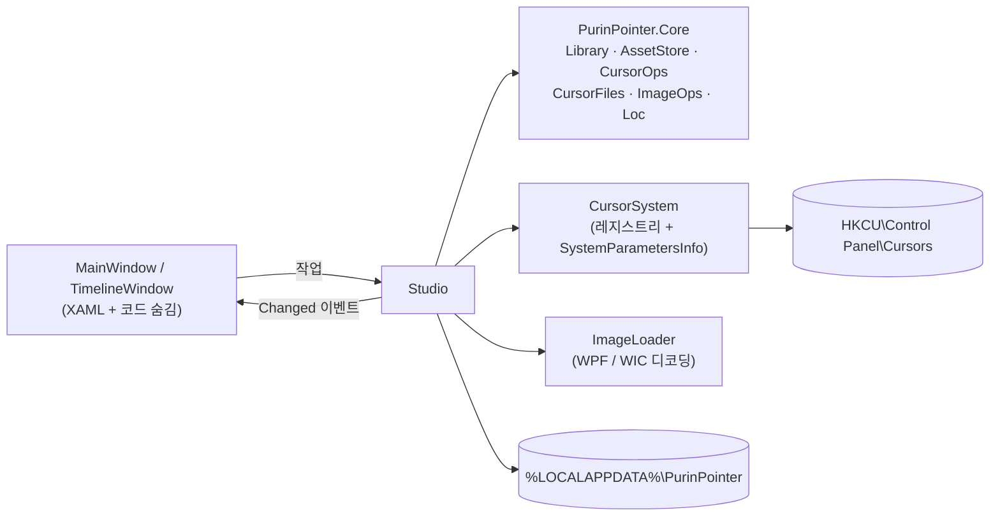
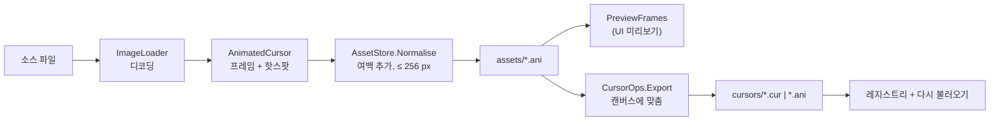

# Purin Pointer 엔지니어링 가이드

[English](engineering.md) · [繁體中文](engineering.tw.md) · [日本語](engineering.ja.md) · **한국어**

Purin Pointer가 어떻게 만들어졌는지, Windows와 어떻게 상호 작용하는지, 그리고 빌드, 테스트, 릴리스 방법을 설명합니다.

## 목차

1. [개요](#1-개요)
2. [저장소 구조](#2-저장소-구조)
3. [빌드 및 실행](#build-and-run)
4. [아키텍처](#4-아키텍처)
5. [데이터 모델과 저장소](#5-데이터-모델과-저장소)
6. [커서 파이프라인](#6-커서-파이프라인)
7. [Windows 연동](#7-windows-연동)
8. [사용자 인터페이스](#8-사용자-인터페이스)
9. [현지화](#9-현지화)
10. [테스트](#10-테스트)
11. [릴리스](#11-릴리스)
12. [알려진 제한 사항](#12-알려진-제한-사항)

---

## 1. 개요

| | |
| --- | --- |
| 언어 / 런타임 | C#(최신), .NET 10 |
| UI | WPF(`net10.0-windows`), 모니터별 DPI 인식(PerMonitorV2) |
| 플랫폼 | Windows 10 / 11, x64 및 ARM64 |
| 종속성 | .NET SDK 외에는 없음(NuGet 패키지 없음) |
| 권한 | 실행한 사용자 권한으로 동작하며 UAC 프롬프트 없음(`asInvoker`) |
| 라이선스 | GPL-3.0 |

## 2. 저장소 구조

```text
PurinPointer.sln
Directory.Build.props          Version, nullable, implicit usings for every project
src/
  PurinPointer.Core/           Platform-neutral logic (net10.0, no WPF / Win32)
    Bitmap32.cs                BGRA image buffer and CursorFrame
    CursorFiles.cs             .cur / .ico / .ani readers and writers
    CursorRole.cs              The 17 Windows pointers and their registry names
    ImageOps.cs                Resampling, GIF composition, background removal, natural sort
    Library.cs                 Themes (Library, Profile, Slot), AssetStore, CursorOps
    Localization.cs            Loc: embedded string tables and language detection
    Versions.cs                Version comparison for the update check
    Strings/*.json             UI strings: en, zh-Hant, zh-Hans, ja, ko
  PurinPointer/                The WPF app (net10.0-windows)
    App.xaml(.cs)              Global styles, unhandled-error handler
    MainWindow.xaml(.cs)       Main window layout and event handlers
    TimelineWindow.xaml(.cs)   Frame ordering dialog
    Studio.cs                  App state and actions (the "view model")
    CursorSystem.cs            Registry, SystemParametersInfo, snapshots
    ImageLoader.cs             WPF/WIC image decoding, GIF frames, PreviewFrames
    AnimatedImage.cs           Image control that plays PreviewFrames
    ThemeManager.cs            Light/dark dictionaries, dark title bar, CJK font selection
    UpdateChecker.cs           GitHub latest-release check
    Themes/Light.xaml, Dark.xaml   Colour palettes
    Assets/                    App icon (.ico) and sidebar logo
    app.manifest               asInvoker, PerMonitorV2
tests/
  PurinPointer.Tests/          Dependency-free test runner for PurinPointer.Core
docs/                          This guide, the user guide, screenshots
```

`PurinPointer.Core`는 의도적으로 Windows 종속성을 두지 않았으므로 어떤 OS에서든 빌드되고 테스트도 실행됩니다. WPF, WIC, 레지스트리를 다루는 코드는 모두 `src/PurinPointer`에 있습니다.

<a id="build-and-run"></a>
## 3. 빌드 및 실행

**요구 사항**: [.NET 10 SDK](https://dotnet.microsoft.com/download) 또는 *.NET 데스크톱 개발* 워크로드가 설치된 Visual Studio 2026. 앱은 Windows에서만 실행되지만, 솔루션은 macOS와 Linux에서도 빌드되므로(`EnableWindowsTargeting`) CI에 유용합니다.

**Visual Studio**: `PurinPointer.sln`을 열고 `PurinPointer`를 시작 프로젝트로 설정한 뒤 **F5**를 누릅니다.

**명령줄**(저장소 루트에서):

앱 실행:

```powershell
dotnet run --project src/PurinPointer
```

테스트 실행(모든 OS):

```powershell
dotnet run --project tests/PurinPointer.Tests
```

단일 파일 릴리스 `.exe` 빌드(ARM은 `-r win-arm64` 사용):

```powershell
dotnet publish src/PurinPointer -c Release -r win-x64 --self-contained -p:PublishSingleFile=true -p:IncludeNativeLibrariesForSelfExtract=true -o publish\win-x64
```

결과물인 `publish\win-x64\PurinPointer.exe`에는 .NET 런타임이 포함되어 있으므로 .NET이 설치되지 않은 PC에서도 실행됩니다. 릴리스 빌드에는 `.pdb`가 포함되지 않습니다(`Directory.Build.props`의 `DebugType=none`).

> [!NOTE]
> 스마트 앱 컨트롤이 켜져 있으면 Windows가 새로 빌드한 서명되지 않은 `PurinPointer.dll`을 차단할 수 있습니다("애플리케이션 제어 정책이 이 파일을 차단했습니다", 영문: "An Application Control policy has blocked this file"). 이 판단은 파일 단위로 이루어지므로, Debug 빌드는 차단되는데 Release 빌드는 실행되거나 그 반대일 수 있습니다. 한쪽 구성이 차단되면 다른 구성을 시도해 보세요.

## 4. 아키텍처



- **`Studio`**는 모든 상태(라이브러리, 선택된 모드, 작업 중 플래그, 상태 메시지)를 보유하고 모든 작업을 수행합니다. 변경이 있을 때마다 `Changed`를 발생시킵니다.
- **`MainWindow`**는 화면 표시에 필요한 세부 사항(확대 여부, 진행 중인 드래그) 외에는 자체 상태가 없습니다. `Changed`가 발생할 때마다 `Refresh()`가 `Studio`를 바탕으로 모든 것을 다시 그립니다. 사이드바는 내용 시그니처가 바뀔 때만 다시 만들어지므로 썸네일 애니메이션이 끊기지 않습니다.
- 오래 걸리는 작업(디코딩, 파일 쓰기, 적용)은 `Studio.Run`을 통해 실행됩니다. `Studio.Run`은 `Busy`를 설정하고 오버레이를 표시하며, 예외는 `Failed` 이벤트를 통해 대화 상자로 보고합니다.
- 처리되지 않은 예외는 `App.OnUnhandledException`에 도달하며, 이 메서드는 앱을 비정상 종료하는 대신 `error.log`를 기록하고 대화 상자를 표시합니다.

## 5. 데이터 모델과 저장소

```text
Library
├─ Profiles: List<Profile>         one per theme
│   └─ Slots: List<Slot>           one per mode: arrow, pointing, text, wait + 12 extra
│       ├─ Asset                   "assets/<guid>.ani" (empty = not set)
│       ├─ Filename                shown under the drop area
│       ├─ Hotspot                 [x, y] as a fraction of the image, or null = file's own
│       └─ OriginalAsset           asset before background removal
├─ Selected, InUse                 theme ids
├─ UndoProfiles                    per theme: the profile before its last edit/apply
├─ AppliedProfiles                 per theme: the profile as last applied
├─ BackupsByTheme                  per theme: "backups/<id>.json" pointer snapshot
└─ Language, Appearance
```

모든 데이터는 `%LOCALAPPDATA%\PurinPointer\`에 있습니다.

| 경로 | 기록 주체 | 내용 |
| --- | --- | --- |
| `library.json` | 변경이 있을 때마다 `Studio.Save` | 위의 `Library`를 들여쓰기한 JSON. `.tmp`에 먼저 쓴 뒤 이동하므로, 비정상 종료가 일어나도 반쯤 쓰인 파일이 남지 않습니다. |
| `assets\*.ani` | `AssetStore.Save` | 가져온 모든 커서를 정규화한 것(아래 참고). 참조되지 않는 파일은 `AssetStore.CollectGarbage`가 삭제합니다. |
| `cursors\*.cur, *.ani` | `CursorSystem.StoreCursorFile` | Windows가 실제로 불러오는 파일. 레지스트리와 스냅샷 어느 쪽에서도 참조하지 않는 파일은 `CursorSystem.CleanUpFiles`가 삭제합니다. |
| `backups\<theme>.json` | `Studio.Apply` | 해당 테마를 적용하기 직전 포인터 설정의 `CursorSnapshot`. |
| `native-reset-recovery.json` | `Studio.RestoreNative` | 마지막으로 *Windows 기본 포인터로 복원*을 실행하기 전의 스냅샷. |
| `error.log` | `App.OnUnhandledException` | 예외의 전체 세부 정보. |

**핫스팟은 이미지에 대한 비율**(0–1)로 저장되므로, 커서를 어떤 크기로 내보내든 올바른 위치를 유지합니다.

**모드 → Windows 포인터 매핑**(`CursorModes.Roles`):

| 슬롯 키 | 레지스트리 값 |
| --- | --- |
| `arrow` | `Arrow` |
| `pointing` | `Hand` |
| `text` | `IBeam` |
| `wait` | `Wait` 및 `AppStarting` |
| `Help`, `Crosshair`, `NWPen`, `No`, `SizeNS`, `SizeWE`, `SizeNWSE`, `SizeNESW`, `SizeAll`, `UpArrow`, `Pin`, `Person` | 같은 이름의 값 |

## 6. 커서 파이프라인



1. **디코딩**(`ImageLoader`). `.ani`는 `AniReader`, `.cur`/`.ico`는 `IconReader`를 거치며, 둘 다 PNG로 압축된 프레임에는 WPF 디코더를 사용합니다. 이미지는 WPF/WIC를 사용하므로 Windows에 설치된 코덱이라면 무엇이든 동작합니다. 애니메이션 GIF는 `GifComposer`가 오프셋과 디스포절 모드를 반영해 프레임별로 합성합니다. 폴더는 펼친 뒤 `NaturalStringComparer`로 정렬합니다.
2. **정규화**(`AssetStore.Normalise`). 크기가 서로 다른 프레임은 여백을 넣어 한 크기로 맞추고, 256px를 넘는 것은 축소하며(`Resampler.Resize`, 미리 곱한 알파에서의 영역 평균) 핫스팟도 그에 맞춰 조정합니다. 결과는 `assets\`에 `.ani`로 저장됩니다.
3. **편집**. 배경 제거(`CursorOps.Knockout`)는 모든 프레임에 실행되어 새 에셋을 기록하고, 이전 에셋은 `OriginalAsset`에 보관합니다. 마술봉은 기준 색을 한 번만 샘플링한 뒤 모든 프레임에서 같은 지점부터 채우기를 수행합니다. 가장자리 제거는 테두리에서 가장 흔한 색을 찾아 모든 테두리 픽셀에서 채우기를 수행합니다.
4. **내보내기**(`CursorOps.Export`). 각 프레임은 `CanvasFor(baseSize)` = 포인터 크기의 2배(64–256px로 제한)인 정사각형 캔버스에 맞춰 가운데 배치됩니다. 핫스팟도 이 캔버스에 맞게 매핑됩니다. 프레임이 하나면 `.cur`(`CurWriter`, AND 마스크가 있는 32비트 DIB), 여러 개면 `.ani`(`AniWriter`, 프레임별 `rate`를 1/60초 지피 단위로 갖는 RIFF `ACON`)가 됩니다.

형식 관련 코드는 모두 `CursorFiles.cs`에 있으며, 왕복 테스트를 거쳤습니다.

## 7. Windows 연동

모든 설정은 사용자별이며, 마우스 제어판이 기록하는 것과 같은 키인 `HKEY_CURRENT_USER\Control Panel\Cursors` 아래에 있습니다. 관리자 권한은 필요하지 않습니다.

### 테마 적용(`Studio.Apply`)

1. 먼저 모든 커서 파일을 만들어, 손상된 에셋이 있으면 Windows를 건드리기 전에 실패하도록 합니다.
2. 현재 값의 `CursorSnapshot`을 `backups\<theme>.json`에 저장합니다.
3. `CursorSystem.ApplyRoles`는 채워진 역할만 기록하고 나머지는 그대로 두며, 구성표 이름을 `Purin Pointer`로 설정하고(`Scheme Source` = 1), `Control Panel\Cursors\Schemes`에도 등록하여 기존 마우스 속성 대화 상자에 나타나도록 합니다.
4. 다시 불러오고(아래 참고), 테마를 `InUse`로 표시한 뒤 `cursors\`에서 참조되지 않는 파일을 삭제합니다.

### 다시 불러오기와 포인터 크기

`CursorSystem.Reload`는 다음을 순서대로 호출합니다.

| 호출 | 목적 |
| --- | --- |
| `SystemParametersInfo(0x2029 /* SPI_SETCURSORBASESIZE */, 0, size, SPIF_UPDATEINIFILE \| SPIF_SENDCHANGE)` | 설정 › 접근성과 같은 방식으로 포인터 크기를 설정합니다. 문서화되지 않았지만 안정적입니다. 이 호출이 없으면 Windows는 메모리에 있는 이전 크기를 유지하며, 그 값을 `CursorBaseSize`에 다시 덮어쓸 수 있습니다. |
| `SystemParametersInfo(SPI_SETCURSORS, 0, NULL, SPIF_UPDATEINIFILE \| SPIF_SENDCHANGE)` | 레지스트리에서 커서를 다시 불러오고 실행 중인 앱에 알립니다. |

> [!IMPORTANT]
> `SPI_SETCURSORS`는 다시 불러오기에 성공했는데도 많은 Windows 10/11 빌드에서 **FALSE와 오류 0**을 반환합니다. 그래서 반환값은 의도적으로 무시합니다. 이를 실패로 처리한 것이 1.0에서 수정된 "Windows가 커서 다시 불러오기를 거부했습니다(오류 0)" 버그의 원인이었습니다.

크기는 `SPI_GETCURSORBASESIZE`(0x2028)로 다시 읽으며, 실패하면 `CursorBaseSize` 레지스트리 값을 사용합니다. `HKCU\Software\Microsoft\Accessibility\CursorSize`(1–15, 1 = 32px이며 한 단계마다 16px 증가)도 함께 갱신하므로 설정의 슬라이더에도 같은 값이 표시됩니다.

### 취소와 복원

- **마지막 변경 취소**(`Studio.Restore`)는 `CursorSystem.Restore`로 테마의 백업 스냅샷을 다시 기록하고, 테마를 `UndoProfiles` 항목으로 교체합니다.
- **Windows 기본 포인터로 복원**(`Studio.RestoreNative`)은 현재 값을 `native-reset-recovery.json`에 저장한 다음, `HKLM\…\Control Panel\Cursors\Schemes`의 *Windows 기본값* 구성표를(없으면 표준 `aero_*` 파일을) 크기 32로 기록합니다.

### "사용 중" 표시를 정확하게 유지하기

시작할 때 `Studio.Load`는 `CursorSystem.UsesAppCursors()`가 `cursors\`에 있는 기존 파일을 가리키는 레지스트리 값을 찾지 못하면 `InUse`를 지웁니다. 이렇게 하면 앱이 닫혀 있는 동안 사용자가 Windows 설정에서 포인터를 바꾼 경우도 처리됩니다.

## 8. 사용자 인터페이스

- **스타일**은 `App.xaml`에 있습니다. 둥근 버튼, 토글 버튼, 텍스트 상자, 콤보 상자, 슬라이더, 얇은 세로 및 가로 스크롤 막대, 메뉴, 체크 상자가 포함됩니다. 모든 색은 `DynamicResource` 키입니다.
- **테마**(`ThemeManager.Apply`)는 병합된 딕셔너리 0을 `Themes/Light.xaml`과 `Themes/Dark.xaml` 사이에서 교체합니다. *system* 모드에서는 `AppsUseLightTheme`를 읽고 `SystemEvents.UserPreferenceChanged`를 수신합니다. 제목 표시줄은 `DwmSetWindowAttribute(DWMWA_USE_IMMERSIVE_DARK_MODE)`를 통해 따라갑니다.
- **글꼴**(`ThemeManager.ApplyFont`)은 `UiFont` 리소스를 Segoe UI 뒤에 선택한 언어의 CJK 글꼴(JhengHei, YaHei, Yu Gothic 또는 Malgun Gothic)을 붙인 목록으로 설정합니다. WPF는 각 글리프를 목록에서 그 글리프를 가진 첫 번째 글꼴로 그리므로, 목록을 고정하면 일본어가 중국어 글꼴로 그려지게 됩니다.
- **애니메이션**은 `AnimatedImage`를 사용합니다. `DispatcherTimer`로 `PreviewFrames`를 차례로 넘기는 `Image`입니다.
- **레이아웃**: 설정 열은 독립적으로 스크롤되고, 미리보기 열의 프레임은 창 크기에 따라 커집니다. 창은 시작할 때 크기를 작업 영역에 맞게 제한하므로 175% 배율의 노트북에서도 화면에 들어갑니다.
- **키보드**: Ctrl + Enter로 테마를 적용하고, Enter로 경로 상자와 핫스팟 X / Y 상자의 입력을 확정합니다.

## 9. 현지화

문자열은 `src/PurinPointer.Core/Strings/`에 있는 JSON 파일이며, `Strings.<code>.json`으로 포함됩니다. `Loc.Instance["key"]`는 현재 언어, 그다음 영어 순으로 찾아보고, 없으면 키 자체를 반환합니다.

언어를 추가하려면:

1. `en.json`을 `<code>.json`으로 복사하고 모든 값을 번역합니다. `{0}` 자리 표시자와 `\n` 줄 바꿈은 그대로 둡니다.
2. `Loc.Languages`에 `new("<code>", "<native name>")`을 추가합니다.
3. `Loc.Detect`에서 시스템 문화권을 매핑합니다.
4. 필요하다면 해당 언어의 UI 글꼴을 `ThemeManager.ApplyFont`에 추가합니다.
5. 테스트를 실행합니다. 키가 빠져 있으면 *every language has every key* 테스트가 실패합니다.

## 10. 테스트

`tests/PurinPointer.Tests`는 이름 붙은 테스트 람다 목록과 작은 `Eq` / `True` 도우미로 이루어진 평범한 콘솔 앱이며, 테스트 프레임워크가 필요 없습니다. 모든 테스트가 통과할 때만 종료 코드 0으로 끝납니다.

테스트 범위: `.cur`/`.ani` 왕복과 경계 사례, 프레임 정규화, GIF 합성, 배경 제거, 핫스팟 내보내기, 라이브러리 JSON 왕복, 테마 추가/복제/삭제, 취소 기록 관리, 모드 → 레지스트리 매핑, 자연 정렬, 버전 비교, 언어 감지, 문자열 테이블 완전성.

테스트를 추가하려면 `Program.cs`의 `tests` 목록에 `("description", () => { ... })` 항목을 덧붙입니다.

WPF 계층(`src/PurinPointer`)에는 자동화된 테스트가 없으므로 앱을 실행해 확인하세요.

## 11. 릴리스

1. `Directory.Build.props`의 `<Version>`을 설정합니다(예: `1.0.1`). 업데이트 확인은 이 값을 GitHub의 최신 릴리스 태그와 비교합니다.
2. 테스트를 실행합니다.
3. 두 아키텍처를 모두 게시하고([빌드 및 실행](#build-and-run) 참고) 각 `PurinPointer.exe`를 `PurinPointer-win-x64.zip`과 `PurinPointer-win-arm64.zip`으로 압축합니다.
4. 커밋하고 푸시한 다음, `main`에서 `v<version>` 태그(예: `v1.0.1`)로 GitHub 릴리스를 만들고 두 ZIP 파일을 첨부합니다.

태그는 `Versions.IsNewer`가 읽습니다. 이 메서드는 앞에 붙은 `v`(그리고 초기 `v.0.1.0` 태그처럼 잘못 들어간 `.`)를 무시한 뒤 숫자 부분을 비교합니다.

## 12. 알려진 제한 사항

- **서명되지 않은 빌드.** 스마트 앱 컨트롤은 이를 차단하고 SmartScreen은 경고를 표시합니다. 코드 서명을 하면 둘 다 해결됩니다.
- **문서화되지 않은 크기 API.** `SPI_SETCURSORBASESIZE`(0x2029)는 Windows 설정이 사용하는 API이지만 공개 SDK에는 없습니다.
- **일부 앱은 자체 커서를 그리며**(많은 게임, 원격 데스크톱 창) 시스템 포인터를 무시합니다.
- WPF 계층에는 **자동화된 UI 테스트가 없습니다**.
