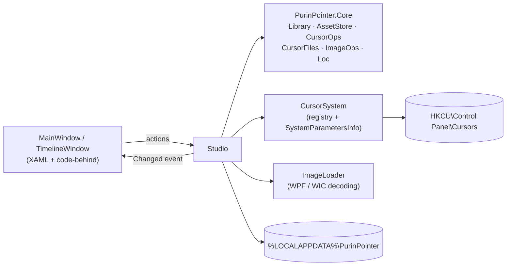
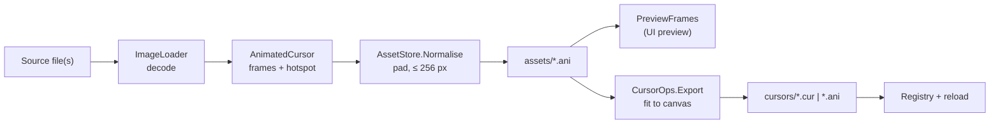

# Purin Pointer Engineering Guide

**English** · [繁體中文](engineering.tw.md) · [日本語](engineering.ja.md) · [한국어](engineering.ko.md)

How Purin Pointer is built, how it talks to Windows, and how to build, test and release it.

## Contents

1. [Overview](#1-overview)
2. [Repository layout](#2-repository-layout)
3. [Build and run](#build-and-run)
4. [Architecture](#4-architecture)
5. [Data model and storage](#5-data-model-and-storage)
6. [Cursor pipeline](#6-cursor-pipeline)
7. [Windows integration](#7-windows-integration)
8. [User interface](#8-user-interface)
9. [Localisation](#9-localisation)
10. [Tests](#10-tests)
11. [Releasing](#11-releasing)
12. [Known limitations](#12-known-limitations)

---

## 1. Overview

| | |
| --- | --- |
| Language / runtime | C# (latest), .NET 10 |
| UI | WPF (`net10.0-windows`), per-monitor DPI aware (PerMonitorV2) |
| Platforms | Windows 10 / 11, x64 and ARM64 |
| Dependencies | None beyond the .NET SDK (no NuGet packages) |
| Privileges | Runs as the invoking user; no UAC prompt (`asInvoker`) |
| License | GPL-3.0 |

## 2. Repository layout

```text
PurinPointer.sln
Directory.Build.props          Version, nullable, implicit usings for every project
src/
  PurinPointer.Core/           Platform-neutral logic (net10.0, no WPF / Win32)
    Bitmap32.cs                BGRA image buffer and CursorFrame
    CursorFiles.cs             .cur / .ico / .ani readers and writers
    CursorRole.cs              The 17 Windows pointers and their registry names
    ImageOps.cs                Resampling, GIF composition, background removal, natural sort
    Library.cs                 Themes (Library, Profile, Slot), AssetStore, CursorOps
    Localization.cs            Loc: embedded string tables and language detection
    Versions.cs                Version comparison for the update check
    Strings/*.json             UI strings: en, zh-Hant, zh-Hans, ja, ko
  PurinPointer/                The WPF app (net10.0-windows)
    App.xaml(.cs)              Global styles, unhandled-error handler
    MainWindow.xaml(.cs)       Main window layout and event handlers
    TimelineWindow.xaml(.cs)   Frame ordering dialog
    Studio.cs                  App state and actions (the "view model")
    CursorSystem.cs            Registry, SystemParametersInfo, snapshots
    ImageLoader.cs             WPF/WIC image decoding, GIF frames, PreviewFrames
    AnimatedImage.cs           Image control that plays PreviewFrames
    ThemeManager.cs            Light/dark dictionaries, dark title bar, CJK font selection
    UpdateChecker.cs           GitHub latest-release check
    Themes/Light.xaml, Dark.xaml   Colour palettes
    Assets/                    App icon (.ico) and sidebar logo
    app.manifest               asInvoker, PerMonitorV2
tests/
  PurinPointer.Tests/          Dependency-free test runner for PurinPointer.Core
docs/                          This guide, the user guide, screenshots
```

`PurinPointer.Core` deliberately has no Windows dependencies, so it builds and its tests run on any OS. Everything that touches WPF, WIC or the registry lives in `src/PurinPointer`.

<a id="build-and-run"></a>
## 3. Build and run

**Requirements**: the [.NET 10 SDK](https://dotnet.microsoft.com/download), or Visual Studio 2026 with the *.NET desktop development* workload. The app runs only on Windows; the solution also builds on macOS and Linux (`EnableWindowsTargeting`), which is useful for CI.

**Visual Studio**: open `PurinPointer.sln`, set `PurinPointer` as the startup project, press **F5**.

**Command line** (from the repository root):

Run the app:

```powershell
dotnet run --project src/PurinPointer
```

Run the tests (any OS):

```powershell
dotnet run --project tests/PurinPointer.Tests
```

Build a single-file release `.exe` (use `-r win-arm64` for ARM):

```powershell
dotnet publish src/PurinPointer -c Release -r win-x64 --self-contained -p:PublishSingleFile=true -p:IncludeNativeLibrariesForSelfExtract=true -o publish\win-x64
```

The result, `publish\win-x64\PurinPointer.exe`, contains the .NET runtime, so it runs on a PC without .NET installed. Release builds ship no `.pdb` (`DebugType=none` in `Directory.Build.props`).

> [!NOTE]
> With Smart App Control on, Windows may block a freshly built, unsigned `PurinPointer.dll` ("An Application Control policy has blocked this file"). The decision is per file, so a Release build can run where a Debug build is blocked, or the other way round. If one configuration is blocked, try the other.

## 4. Architecture



- **`Studio`** holds all state (the library, the selected mode, busy flag, status message) and performs every action. It raises `Changed` after each change.
- **`MainWindow`** has no state of its own beyond view details (zoom, drag in progress). Its `Refresh()` redraws everything from `Studio` on each `Changed`. The sidebar is only rebuilt when its content signature changes, so thumbnails keep animating.
- Long operations (decoding, writing files, applying) run through `Studio.Run`, which sets `Busy`, shows the overlay and reports exceptions through the `Failed` event as a dialog.
- Unhandled exceptions reach `App.OnUnhandledException`, which writes `error.log` and shows a dialog instead of crashing.

## 5. Data model and storage

```text
Library
├─ Profiles: List<Profile>         one per theme
│   └─ Slots: List<Slot>           one per mode: arrow, pointing, text, wait + 12 extra
│       ├─ Asset                   "assets/<guid>.ani" (empty = not set)
│       ├─ Filename                shown under the drop area
│       ├─ Hotspot                 [x, y] as a fraction of the image, or null = file's own
│       └─ OriginalAsset           asset before background removal
├─ Selected, InUse                 theme ids
├─ UndoProfiles                    per theme: the profile before its last edit/apply
├─ AppliedProfiles                 per theme: the profile as last applied
├─ BackupsByTheme                  per theme: "backups/<id>.json" pointer snapshot
└─ Language, Appearance
```

All data lives in `%LOCALAPPDATA%\PurinPointer\`:

| Path | Written by | Contents |
| --- | --- | --- |
| `library.json` | `Studio.Save` after every change | The `Library` above, indented JSON. Written to `.tmp` and moved, so a crash never leaves a half-written file. |
| `assets\*.ani` | `AssetStore.Save` | Every imported cursor, normalised (see below). Unreferenced files are deleted by `AssetStore.CollectGarbage`. |
| `cursors\*.cur, *.ani` | `CursorSystem.StoreCursorFile` | The files Windows actually loads. `CursorSystem.CleanUpFiles` deletes any that neither the registry nor a snapshot refers to. |
| `backups\<theme>.json` | `Studio.Apply` | `CursorSnapshot` of the pointer settings just before that theme was applied. |
| `native-reset-recovery.json` | `Studio.RestoreNative` | Snapshot from before the last *Restore Windows appearance*. |
| `error.log` | `App.OnUnhandledException` | Full exception details. |

**Hotspots are stored as fractions** (0–1) of the image, so they stay correct whatever size the cursor is exported at.

**Mode → Windows pointer mapping** (`CursorModes.Roles`):

| Slot key | Registry value(s) |
| --- | --- |
| `arrow` | `Arrow` |
| `pointing` | `Hand` |
| `text` | `IBeam` |
| `wait` | `Wait` and `AppStarting` |
| `Help`, `Crosshair`, `NWPen`, `No`, `SizeNS`, `SizeWE`, `SizeNWSE`, `SizeNESW`, `SizeAll`, `UpArrow`, `Pin`, `Person` | the value of the same name |

## 6. Cursor pipeline



1. **Decode** (`ImageLoader`). `.ani` goes through `AniReader`, `.cur`/`.ico` through `IconReader`; both use WPF's decoder for PNG-compressed frames. Images use WPF/WIC, so any codec Windows has installed works. Animated GIFs are composed frame by frame by `GifComposer`, honouring offsets and disposal modes. A folder is expanded and sorted with `NaturalStringComparer`.
2. **Normalise** (`AssetStore.Normalise`). Mixed frame sizes are padded to one size; anything over 256 px is downscaled (`Resampler.Resize`, area averaging in premultiplied alpha) and the hotspot scaled to match. The result is stored as a `.ani` in `assets\`.
3. **Edit**. Background removal (`CursorOps.Knockout`) runs on every frame and writes a new asset, keeping the previous one in `OriginalAsset`. The magic wand samples the seed colour once and floods from the same point on every frame. Edge removal finds the most common border colour and floods from all border pixels.
4. **Export** (`CursorOps.Export`). Each frame is fitted, centred, onto a square canvas of `CanvasFor(baseSize)` = 2 × pointer size, clamped to 64–256 px. The hotspot is mapped onto that canvas. One frame becomes `.cur` (`CurWriter`, 32-bit DIB with AND mask); several become `.ani` (`AniWriter`, RIFF `ACON` with per-frame `rate` in 1/60 s jiffies).

All format code is in `CursorFiles.cs` and round-trip tested.

## 7. Windows integration

Everything is per user, under `HKEY_CURRENT_USER\Control Panel\Cursors`, the same key the Mouse control panel writes. No administrator rights are needed.

### Applying a theme (`Studio.Apply`)

1. Build every cursor file first, so a broken asset fails before Windows is touched.
2. Save a `CursorSnapshot` of the current values to `backups\<theme>.json`.
3. `CursorSystem.ApplyRoles` writes only the filled roles, keeps the others, sets the scheme name to `Purin Pointer` (`Scheme Source` = 1), and also registers it under `Control Panel\Cursors\Schemes`, so it appears in the classic Mouse Properties dialog.
4. Reload (below), mark the theme `InUse`, delete unreferenced files in `cursors\`.

### Reloading and the pointer size

`CursorSystem.Reload` calls, in order:

| Call | Purpose |
| --- | --- |
| `SystemParametersInfo(0x2029 /* SPI_SETCURSORBASESIZE */, 0, size, SPIF_UPDATEINIFILE \| SPIF_SENDCHANGE)` | Sets the pointer size the way Settings › Accessibility does. Undocumented but stable. Without it, Windows keeps its old in-memory size and can write it back over `CursorBaseSize`. |
| `SystemParametersInfo(SPI_SETCURSORS, 0, NULL, SPIF_UPDATEINIFILE \| SPIF_SENDCHANGE)` | Reloads the cursors from the registry and notifies running apps. |

> [!IMPORTANT]
> `SPI_SETCURSORS` returns **FALSE with error 0** on many Windows 10/11 builds even though the reload succeeds. Its return value is intentionally ignored. Treating it as a failure caused the "Windows refused to reload the cursors (error 0)" bug fixed in 1.0.

The size is read back with `SPI_GETCURSORBASESIZE` (0x2028), falling back to the `CursorBaseSize` registry value. `HKCU\Software\Microsoft\Accessibility\CursorSize` (1–15, where 1 = 32 px and each step adds 16 px) is updated as well, so the Settings slider shows the same value.

### Undo and restore

- **Undo last change** (`Studio.Restore`) writes the theme's backup snapshot back with `CursorSystem.Restore`, and swaps the theme for its `UndoProfiles` entry.
- **Restore Windows appearance** (`Studio.RestoreNative`) saves the current values to `native-reset-recovery.json`, then writes the *Windows Default* scheme from `HKLM\…\Control Panel\Cursors\Schemes` (falling back to the standard `aero_*` files) with size 32.

### Keeping "In use" honest

On start-up, `Studio.Load` clears `InUse` unless `CursorSystem.UsesAppCursors()` finds a registry value pointing at an existing file in `cursors\`. This covers the user changing pointers in Windows Settings while the app was closed.

## 8. User interface

- **Styles** live in `App.xaml`: rounded buttons, toggle buttons, text boxes, combo boxes, sliders, slim vertical and horizontal scroll bars, menus and check boxes. All colours are `DynamicResource` keys.
- **Themes** (`ThemeManager.Apply`) swap merged dictionary 0 between `Themes/Light.xaml` and `Themes/Dark.xaml`. In *system* mode it reads `AppsUseLightTheme` and listens to `SystemEvents.UserPreferenceChanged`. The title bar follows via `DwmSetWindowAttribute(DWMWA_USE_IMMERSIVE_DARK_MODE)`.
- **Fonts** (`ThemeManager.ApplyFont`) set the `UiFont` resource to Segoe UI followed by the CJK font of the selected language (JhengHei, YaHei, Yu Gothic or Malgun Gothic). WPF picks each glyph from the first font in the list that has it, so a fixed list would draw Japanese with a Chinese font.
- **Animation** uses `AnimatedImage`, an `Image` with a `DispatcherTimer` that steps through `PreviewFrames`.
- **Layout**: the settings column scrolls independently; the preview column's frame grows with the window. The window clamps its size to the work area at start-up, so it fits 175 % laptops.
- **Keyboard**: Ctrl + Enter applies the theme; Enter confirms the path box and the hotspot X / Y boxes.

## 9. Localisation

Strings are JSON files in `src/PurinPointer.Core/Strings/`, embedded as `Strings.<code>.json`. `Loc.Instance["key"]` looks up the current language, then English, then returns the key itself.

To add a language:

1. Copy `en.json` to `<code>.json` and translate every value. Keep `{0}` placeholders and `\n` line breaks.
2. Add `new("<code>", "<native name>")` to `Loc.Languages`.
3. Map the system culture in `Loc.Detect`.
4. Add the language's UI font to `ThemeManager.ApplyFont` if it needs one.
5. Run the tests: *every language has every key* fails if a key is missing.

## 10. Tests

`tests/PurinPointer.Tests` is a plain console app with a list of named test lambdas and small `Eq` / `True` helpers; no test framework is needed. It exits with code 0 only if every test passes.

Covered: `.cur`/`.ani` round trips and edge cases, frame normalisation, GIF composition, background removal, hotspot export, library JSON round trip, theme add/duplicate/remove, undo bookkeeping, mode → registry mapping, natural sort, version comparison, language detection, and string-table completeness.

To add a test, append a `("description", () => { ... })` entry to the `tests` list in `Program.cs`.

The WPF layer (`src/PurinPointer`) has no automated tests; check it by running the app.

## 11. Releasing

1. Set `<Version>` in `Directory.Build.props` (for example `1.0.1`). The update check compares this against the latest GitHub release tag.
2. Run the tests.
3. Publish both architectures (see [Build and run](#build-and-run)) and zip each `PurinPointer.exe` as `PurinPointer-win-x64.zip` and `PurinPointer-win-arm64.zip`.
4. Commit, push, then create a GitHub release with the tag `v<version>` (for example `v1.0.1`) on `main`, and attach both ZIPs.

Tags are read by `Versions.IsNewer`, which ignores a leading `v` (and a stray `.`, as in the early `v.0.1.0` tag), then compares numeric parts.

## 12. Known limitations

- **Unsigned builds.** Smart App Control blocks them; SmartScreen warns. Code signing would fix both.
- **Undocumented size API.** `SPI_SETCURSORBASESIZE` (0x2029) is what Windows Settings uses but is not in the public SDK.
- **Some apps draw their own cursor** (many games, remote-desktop windows) and ignore the system pointers.
- **No automated UI tests** for the WPF layer.
