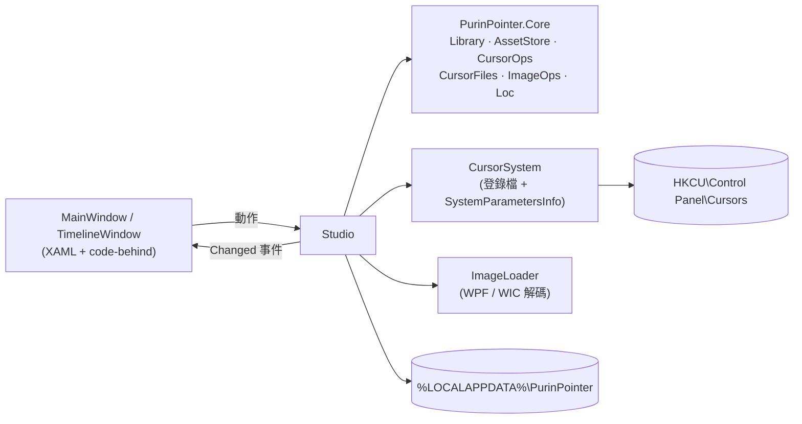
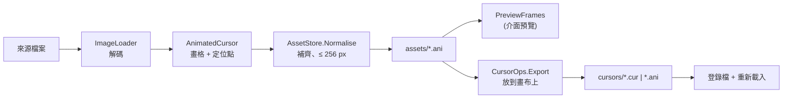

# Purin Pointer 工程說明

[English](engineering.md) · **繁體中文** · [日本語](engineering.ja.md) · [한국어](engineering.ko.md)

說明 Purin Pointer 的架構、它如何與 Windows 溝通，以及如何建置、測試與發佈。

## 目錄

1. [概觀](#1-概觀)
2. [專案結構](#2-專案結構)
3. [建置與執行](#build-and-run)
4. [架構](#4-架構)
5. [資料模型與儲存](#5-資料模型與儲存)
6. [游標處理流程](#6-游標處理流程)
7. [與 Windows 的整合](#7-與-windows-的整合)
8. [使用者介面](#8-使用者介面)
9. [多國語言](#9-多國語言)
10. [測試](#10-測試)
11. [發佈流程](#11-發佈流程)
12. [已知限制](#12-已知限制)

---

## 1. 概觀

| | |
| --- | --- |
| 語言／執行環境 | C#（latest）、.NET 10 |
| 介面 | WPF（`net10.0-windows`），支援各螢幕獨立 DPI（PerMonitorV2） |
| 平台 | Windows 10／11，x64 與 ARM64 |
| 相依套件 | 除了 .NET SDK 之外沒有任何相依（不使用 NuGet 套件） |
| 權限 | 以目前使用者身分執行，不會跳出 UAC（`asInvoker`） |
| 授權 | GPL-3.0 |

## 2. 專案結構

```text
PurinPointer.sln
Directory.Build.props          所有專案共用的版本、nullable、implicit usings
src/
  PurinPointer.Core/           與平台無關的邏輯（net10.0，不含 WPF／Win32）
    Bitmap32.cs                BGRA 影像緩衝區與 CursorFrame
    CursorFiles.cs             .cur／.ico／.ani 的讀取與寫入
    CursorRole.cs              17 種 Windows 指標與它們的登錄檔名稱
    ImageOps.cs                縮放、GIF 合成、去背、自然排序
    Library.cs                 主題（Library、Profile、Slot）、AssetStore、CursorOps
    Localization.cs            Loc：內嵌字串表與語言偵測
    Versions.cs                更新檢查用的版本比較
    Strings/*.json             介面文字：en、zh-Hant、zh-Hans、ja、ko
  PurinPointer/                WPF 程式（net10.0-windows）
    App.xaml(.cs)              全域樣式、未處理例外的處理
    MainWindow.xaml(.cs)       主視窗版面與事件處理
    TimelineWindow.xaml(.cs)   畫格排序對話框
    Studio.cs                  程式狀態與所有動作（相當於 view model）
    CursorSystem.cs            登錄檔、SystemParametersInfo、設定快照
    ImageLoader.cs             WPF／WIC 影像解碼、GIF 畫格、PreviewFrames
    AnimatedImage.cs           播放 PreviewFrames 的 Image 控制項
    ThemeManager.cs            淺色／深色資源、深色標題列、CJK 字型選擇
    UpdateChecker.cs           檢查 GitHub 最新版本
    Themes/Light.xaml, Dark.xaml   配色
    Assets/                    程式圖示（.ico）與側欄 logo
    app.manifest               asInvoker、PerMonitorV2
tests/
  PurinPointer.Tests/          PurinPointer.Core 的測試程式，不依賴任何測試框架
docs/                          本說明、操作手冊、截圖
```

`PurinPointer.Core` 刻意不依賴 Windows，所以可以在任何作業系統上建置與執行測試。所有用到 WPF、WIC 或登錄檔的程式碼都放在 `src/PurinPointer`。

<a id="build-and-run"></a>
## 3. 建置與執行

**需求**：[.NET 10 SDK](https://dotnet.microsoft.com/download)，或安裝了「.NET 桌面開發」工作負載的 Visual Studio 2026。程式只能在 Windows 上執行；方案在 macOS 與 Linux 上也能建置（`EnableWindowsTargeting`），方便用於 CI。

**Visual Studio**：開啟 `PurinPointer.sln`，把 `PurinPointer` 設為啟動專案，按 **F5**。

**命令列**（在 repo 根目錄執行）：

執行程式：

```powershell
dotnet run --project src/PurinPointer
```

執行測試（任何作業系統都可以）：

```powershell
dotnet run --project tests/PurinPointer.Tests
```

建置單一檔案的發佈版 `.exe`（ARM 版改用 `-r win-arm64`）：

```powershell
dotnet publish src/PurinPointer -c Release -r win-x64 --self-contained -p:PublishSingleFile=true -p:IncludeNativeLibrariesForSelfExtract=true -o publish\win-x64
```

產生的 `publish\win-x64\PurinPointer.exe` 內含 .NET 執行環境，在沒有安裝 .NET 的電腦上也能執行。Release 版不附 `.pdb`（`Directory.Build.props` 裡的 `DebugType=none`）。

> [!NOTE]
> 開啟「智慧型應用程式控制」時，Windows 可能會封鎖剛建置、沒有簽章的 `PurinPointer.dll`（「應用程式控制原則已封鎖此檔案」）。這是逐檔判斷的，所以可能 Release 版能執行而 Debug 版被封鎖，反之亦然。其中一種被封鎖時，可以試試另一種。

## 4. 架構



- **`Studio`** 持有所有狀態（主題庫、目前的模式、忙碌旗標、狀態訊息），也負責執行所有動作。每次變更後會觸發 `Changed`。
- **`MainWindow`** 除了畫面細節（縮放、拖曳中）之外沒有自己的狀態。每次 `Changed` 時，`Refresh()` 會依照 `Studio` 重畫所有內容。側欄只在內容簽章改變時才重建，縮圖動畫才不會中斷。
- 耗時的操作（解碼、寫檔、套用）都透過 `Studio.Run` 執行：它會設定 `Busy`、顯示遮罩，並把例外透過 `Failed` 事件以對話框顯示。
- 未處理的例外會交給 `App.OnUnhandledException`，寫入 `error.log` 並顯示對話框，程式不會直接當掉。

## 5. 資料模型與儲存

```text
Library
├─ Profiles: List<Profile>         每個主題一個
│   └─ Slots: List<Slot>           每個模式一個：arrow、pointing、text、wait 以及 12 個額外指標
│       ├─ Asset                   "assets/<guid>.ani"（空字串表示未設定）
│       ├─ Filename                顯示在匯入區塊下方
│       ├─ Hotspot                 [x, y]，以圖片的比例表示；null 表示使用檔案本身的定位點
│       └─ OriginalAsset           去背前的素材
├─ Selected, InUse                 主題 id
├─ UndoProfiles                    每個主題：上次編輯／套用前的狀態
├─ AppliedProfiles                 每個主題：上次套用時的狀態
├─ BackupsByTheme                  每個主題："backups/<id>.json" 指標設定快照
└─ Language, Appearance
```

所有資料都在 `%LOCALAPPDATA%\PurinPointer\`：

| 路徑 | 寫入者 | 內容 |
| --- | --- | --- |
| `library.json` | 每次變更後的 `Studio.Save` | 上面的 `Library`，縮排 JSON。先寫成 `.tmp` 再移動，就算當機也不會留下寫到一半的檔案。 |
| `assets\*.ani` | `AssetStore.Save` | 每個匯入的游標，經過正規化（見下方）。沒有被參照的檔案由 `AssetStore.CollectGarbage` 刪除。 |
| `cursors\*.cur, *.ani` | `CursorSystem.StoreCursorFile` | Windows 實際載入的檔案。登錄檔和快照都沒有參照的檔案，由 `CursorSystem.CleanUpFiles` 刪除。 |
| `backups\<theme>.json` | `Studio.Apply` | 該主題套用前一刻的指標設定 `CursorSnapshot`。 |
| `native-reset-recovery.json` | `Studio.RestoreNative` | 上次「恢復 Windows 原生外觀」之前的快照。 |
| `error.log` | `App.OnUnhandledException` | 完整的例外資訊。 |

**定位點以比例（0–1）儲存**，所以不論游標以什麼大小輸出，位置都正確。

**模式與 Windows 指標的對應**（`CursorModes.Roles`）：

| Slot key | 登錄檔值 |
| --- | --- |
| `arrow` | `Arrow` |
| `pointing` | `Hand` |
| `text` | `IBeam` |
| `wait` | `Wait` 與 `AppStarting` |
| `Help`、`Crosshair`、`NWPen`、`No`、`SizeNS`、`SizeWE`、`SizeNWSE`、`SizeNESW`、`SizeAll`、`UpArrow`、`Pin`、`Person` | 同名的值 |

## 6. 游標處理流程



1. **解碼**（`ImageLoader`）：`.ani` 交給 `AniReader`，`.cur`／`.ico` 交給 `IconReader`，兩者都用 WPF 的解碼器處理 PNG 壓縮的畫格。圖片使用 WPF／WIC，所以 Windows 安裝的任何解碼器都能用。動態 GIF 由 `GifComposer` 逐格合成，會照顧位移與 disposal 模式。資料夾會展開並用 `NaturalStringComparer` 排序。
2. **正規化**（`AssetStore.Normalise`）：大小不一的畫格會補齊成同一個尺寸；超過 256 px 的會縮小（`Resampler.Resize`，在 premultiplied alpha 下做面積平均），定位點也等比例調整。結果以 `.ani` 存到 `assets\`。
3. **編輯**：去背（`CursorOps.Knockout`）會處理每一格並寫成新的素材，原本的素材保留在 `OriginalAsset`。魔術棒只取樣一次種子顏色，再從同一點對每一格做填充。自動去背會找出邊框最常見的顏色，從所有邊框像素開始填充。
4. **輸出**（`CursorOps.Export`）：每一格會置中縮放到 `CanvasFor(baseSize)` 的正方形畫布上，也就是指標大小的 2 倍，限制在 64–256 px 之間，定位點也對應到畫布上。只有一格時輸出 `.cur`（`CurWriter`，32 位元 DIB 加 AND mask）；多格時輸出 `.ani`（`AniWriter`，RIFF `ACON`，每格的 `rate` 以 1/60 秒為單位）。

所有檔案格式的程式碼都在 `CursorFiles.cs`，並有來回轉換的測試。

## 7. 與 Windows 的整合

所有設定都是個人設定，位於 `HKEY_CURRENT_USER\Control Panel\Cursors`，也就是「滑鼠」控制台寫入的同一個位置，因此不需要系統管理員權限。

### 套用主題（`Studio.Apply`）

1. 先產生所有游標檔，素材有問題時在動到 Windows 之前就會失敗。
2. 把目前的設定存成 `CursorSnapshot`，寫到 `backups\<theme>.json`。
3. `CursorSystem.ApplyRoles` 只寫入有填的指標、保留其他指標，把配置名稱設為 `Purin Pointer`（`Scheme Source` = 1），並同時登錄到 `Control Panel\Cursors\Schemes`，讓它出現在傳統的「滑鼠內容」對話框中。
4. 重新載入（見下方），把主題標為 `InUse`，並刪除 `cursors\` 裡沒有被參照的檔案。

### 重新載入與指標大小

`CursorSystem.Reload` 依序呼叫：

| 呼叫 | 用途 |
| --- | --- |
| `SystemParametersInfo(0x2029 /* SPI_SETCURSORBASESIZE */, 0, size, SPIF_UPDATEINIFILE \| SPIF_SENDCHANGE)` | 以「設定 › 協助工具」相同的方式設定指標大小。沒有公開文件但很穩定。少了這一步，Windows 會保留記憶體中的舊大小，還可能把它寫回 `CursorBaseSize`。 |
| `SystemParametersInfo(SPI_SETCURSORS, 0, NULL, SPIF_UPDATEINIFILE \| SPIF_SENDCHANGE)` | 從登錄檔重新載入游標，並通知執行中的程式。 |

> [!IMPORTANT]
> 在許多 Windows 10／11 版本上，`SPI_SETCURSORS` 即使重新載入成功，也會**回傳 FALSE 且錯誤碼為 0**。程式刻意忽略它的回傳值。把它當成失敗正是 1.0 修正的「Windows refused to reload the cursors (error 0)」錯誤的原因。

指標大小以 `SPI_GETCURSORBASESIZE`（0x2028）讀回，讀不到時改讀登錄檔的 `CursorBaseSize`。同時也會更新 `HKCU\Software\Microsoft\Accessibility\CursorSize`（1–15，1 = 32 px，每一級加 16 px），讓「設定」裡的滑桿顯示相同的值。

### 復原與恢復

- **復原上次變更**（`Studio.Restore`）用 `CursorSystem.Restore` 把該主題的備份快照寫回，並把主題換回 `UndoProfiles` 裡的版本。
- **恢復 Windows 原生外觀**（`Studio.RestoreNative`）先把目前的值存到 `native-reset-recovery.json`，再寫入 `HKLM\…\Control Panel\Cursors\Schemes` 裡的 *Windows Default* 配置（找不到時使用標準的 `aero_*` 檔案），並把大小設為 32。

### 讓「使用中」保持正確

啟動時，除非 `CursorSystem.UsesAppCursors()` 找到指向 `cursors\` 中現存檔案的登錄檔值，否則 `Studio.Load` 會清除 `InUse`。這樣就算使用者在程式關閉時從 Windows 設定改了指標，標籤也會正確。

## 8. 使用者介面

- **樣式**都在 `App.xaml`：圓角按鈕、切換按鈕、文字框、下拉選單、滑桿、細長的垂直與水平捲軸、選單與核取方塊。所有顏色都是 `DynamicResource`。
- **主題**（`ThemeManager.Apply`）在 `Themes/Light.xaml` 與 `Themes/Dark.xaml` 之間切換第 0 個合併字典。「跟隨系統」模式會讀取 `AppsUseLightTheme`，並監聽 `SystemEvents.UserPreferenceChanged`。標題列透過 `DwmSetWindowAttribute(DWMWA_USE_IMMERSIVE_DARK_MODE)` 跟著切換。
- **字型**（`ThemeManager.ApplyFont`）把 `UiFont` 資源設為 Segoe UI，後面接所選語言的 CJK 字型（正黑體、雅黑、Yu Gothic 或 Malgun Gothic）。WPF 會從清單中第一個有該字元的字型取字，若清單固定不變，日文就會用中文字型顯示。
- **動畫**使用 `AnimatedImage`：一個以 `DispatcherTimer` 逐格播放 `PreviewFrames` 的 `Image`。
- **版面**：設定欄單獨捲動，預覽框會隨視窗變大。視窗啟動時會把大小限制在工作區域內，在 175% 縮放的筆電上也放得下。
- **鍵盤**：Ctrl + Enter 套用主題；在路徑欄與定位點 X／Y 欄按 Enter 確認。

## 9. 多國語言

介面文字是 `src/PurinPointer.Core/Strings/` 裡的 JSON 檔，以 `Strings.<code>.json` 的名稱內嵌。`Loc.Instance["key"]` 會先找目前的語言，再找英文，最後回傳 key 本身。

新增語言的步驟：

1. 把 `en.json` 複製成 `<code>.json` 並翻譯所有值。保留 `{0}` 這類佔位符與 `\n` 換行。
2. 在 `Loc.Languages` 加入 `new("<code>", "<語言原名>")`。
3. 在 `Loc.Detect` 對應系統文化設定。
4. 如果需要專用字型，加到 `ThemeManager.ApplyFont`。
5. 執行測試：有缺少的 key 時，「every language has every key」會失敗。

## 10. 測試

`tests/PurinPointer.Tests` 是一個普通的主控台程式，包含一串具名的測試 lambda 與簡單的 `Eq`／`True` 輔助函式，不需要測試框架。只有全部通過時才會以代碼 0 結束。

涵蓋範圍：`.cur`／`.ani` 的來回轉換與邊界情況、畫格正規化、GIF 合成、去背、定位點輸出、主題庫 JSON 來回轉換、主題新增／複製／刪除、復原紀錄、模式與登錄檔的對應、自然排序、版本比較、語言偵測，以及字串表是否完整。

新增測試時，在 `Program.cs` 的 `tests` 清單加入一筆 `("描述", () => { ... })`。

WPF 層（`src/PurinPointer`）沒有自動化測試，請實際執行程式確認。

## 11. 發佈流程

1. 修改 `Directory.Build.props` 裡的 `<Version>`（例如 `1.0.1`）。更新檢查會拿它和 GitHub 最新 release 的標籤比較。
2. 執行測試。
3. 發佈兩種架構（見[建置與執行](#build-and-run)），把各自的 `PurinPointer.exe` 壓縮成 `PurinPointer-win-x64.zip` 與 `PurinPointer-win-arm64.zip`。
4. Commit 並 push，接著在 GitHub 以 `main` 建立標籤為 `v<版本>`（例如 `v1.0.1`）的 release，並附上兩個 ZIP。

標籤由 `Versions.IsNewer` 讀取：它會忽略開頭的 `v`（以及早期 `v.0.1.0` 標籤裡多出來的 `.`），再逐段比較數字。

## 12. 已知限制

- **沒有簽章**：「智慧型應用程式控制」會封鎖，SmartScreen 會警告。程式碼簽章可以同時解決這兩個問題。
- **沒有公開文件的大小 API**：`SPI_SETCURSORBASESIZE`（0x2029）是 Windows 設定使用的方式，但不在公開 SDK 裡。
- **有些程式會自己繪製游標**（許多遊戲、遠端桌面視窗），不會使用系統指標。
- WPF 層**沒有自動化介面測試**。
