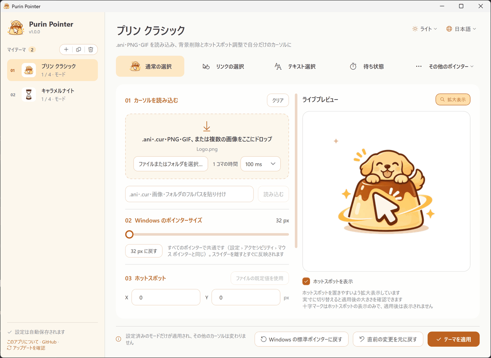
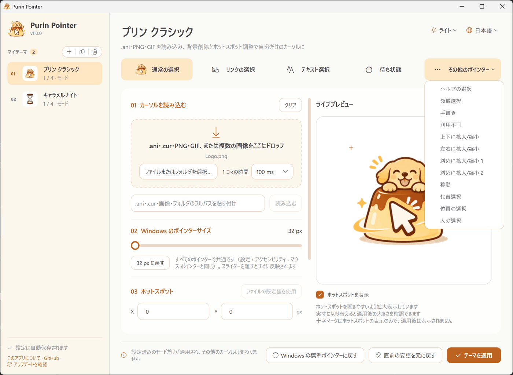
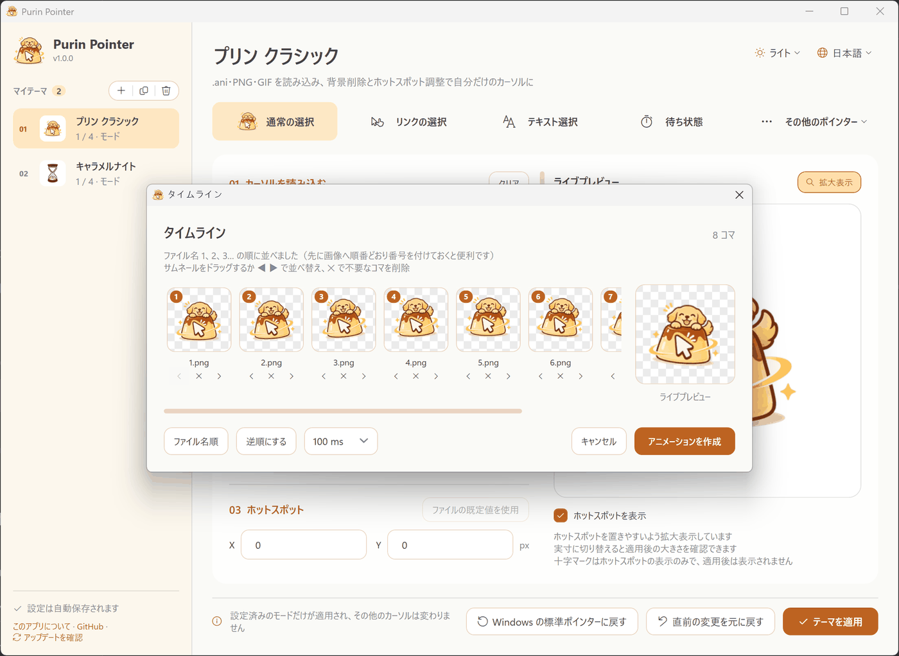
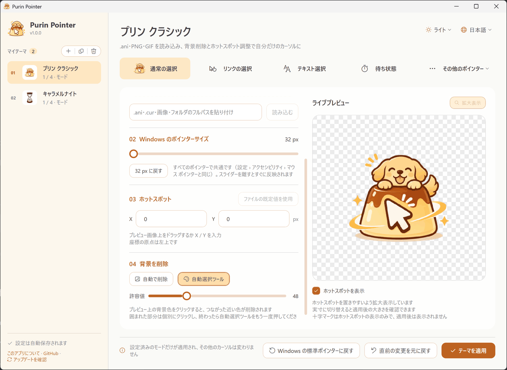
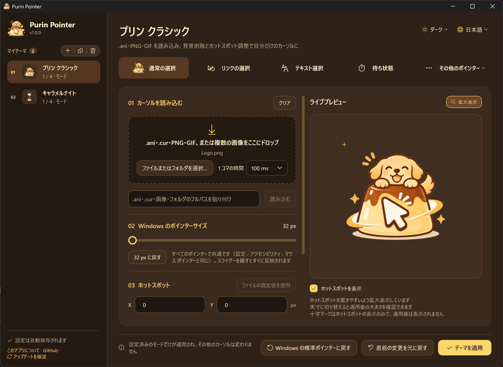

# Purin Pointer ユーザーガイド

[English](user-guide.md) · [繁體中文](user-guide.tw.md) · **日本語** · [한국어](user-guide.ko.md)

このガイドでは、初回起動からトラブルシューティングまで、Purin Pointer 1.0 のすべての機能を説明します。ボタン名は、アプリに表示されるとおりに **太字** で記載しています。

## 目次

1. [インストールと初回起動](#1-インストールと初回起動)
2. [メインウィンドウ](#2-メインウィンドウ)
3. [テーマ](#3-テーマ)
4. [モードとポインター](#4-モードとポインター)
5. [カーソルの読み込み](#5-カーソルの読み込み)
6. [タイムライン](#6-タイムライン)
7. [背景の削除](#7-背景の削除)
8. [ホットスポットの設定](#8-ホットスポットの設定)
9. [ライブプレビュー](#9-ライブプレビュー)
10. [Windows のポインターサイズ](#10-windows-のポインターサイズ)
11. [テーマの適用と元に戻す方法](#11-テーマの適用と元に戻す方法)
12. [外観や言語の設定とアップデート](#12-外観や言語の設定とアップデート)
13. [データの保存場所](#13-データの保存場所)
14. [トラブルシューティング](#14-トラブルシューティング)

---

## 1. インストールと初回起動

1. [Releases](https://github.com/Yucheng0208/Purin-Pointer/releases/latest) からダウンロードします。
   - `PurinPointer-win-x64.zip`：ほとんどの Windows PC（Intel / AMD）向け
   - `PurinPointer-win-arm64.zip`：ARM ノート PC（Snapdragon など）向け
2. ZIP を任意の場所（例：ドキュメント フォルダ）に展開します。
3. `PurinPointer.exe` をダブルクリックします。インストールは不要で、.NET も内蔵されています。

**「Windows によって PC が保護されました」と表示された場合** は、**詳細情報** をクリックしてから **実行** をクリックします。展開する前に ZIP を右クリックして **プロパティ** を選び、**許可する** にチェックを入れる方法もあります。

**アプリがブロックされたと表示され、「実行」が出てこない場合** は、スマート アプリ コントロールがオンになっています。リリース版はコード署名されていないため、このモードの Windows 11 では一律にブロックされます。代わりにソースからアプリをビルドしてください（[エンジニアリングガイド](engineering.ja.md#build-and-run) を参照）。

Purin Pointer が管理者権限を求めることはありません。変更するのは、ご自身のユーザーのポインター設定だけです。

初回起動時は、システムの言語で起動し、空のテーマが 1 つ作成されます。

## 2. メインウィンドウ

| 領域 | 機能 |
| --- | --- |
| **サイドバー**（左） | テーマの一覧です。一覧の上にあるボタンで、テーマの追加・複製・削除ができます。 |
| **テーマ名**（上部） | 名前をクリックするとテーマ名を変更できます。 |
| **外観** と **言語**（右上） | ライト／ダークの外観と、表示言語を切り替えます。 |
| **モードのタブ** | **通常の選択**、**リンクの選択**、**テキスト選択**、**待ち状態**、**その他のポインター**。設定済みのタブにはそのカーソルが表示されます。 |
| **01 カーソルを読み込む** | 選択中のモードに使うファイルをドロップするか選択します。 |
| **02 Windows のポインターサイズ** | Windows 全体で使われるポインターのサイズです。 |
| **03 ホットスポット** | 実際にクリックされる正確な位置です。 |
| **04 背景を削除** | 自動で削除と自動選択ツールです。 |
| **ライブプレビュー**（右） | ホットスポットの十字付きで、カーソルの実際の見た目を表示します。 |
| **フッター** | ステータスメッセージ、**Windows の標準ポインターに戻す**、**直前の変更を元に戻す**、**テーマを適用**。 |

左側の設定列は単独でスクロールするため、プレビューは常に表示されたままです。

## 3. テーマ

テーマは、モードごとに 1 つずつのカーソルをまとめたセットです。テーマはいくつでも作成でき、いつでも切り替えられます。

| 操作 | 方法 |
| --- | --- |
| 空のテーマを作成する | 一覧の上にある **+**（**新しいテーマ**）をクリックします。 |
| 選択中のテーマをコピーする | コピーのボタン（**複製**）をクリックします。 |
| 選択中のテーマを削除する | ごみ箱のボタン（**削除**）をクリックして確認します。最後の 1 つのテーマは削除できません。 |
| テーマ名を変更する | ウィンドウ上部の名前をクリックして入力します。 |
| テーマを切り替える | サイドバーでテーマをクリックします。 |

各行には、サムネール、名前、主な 4 つのモードのうち設定済みの数（例：`1 / 4 · モード`、その他のポインターが設定済みなら `+2` も）が表示されます。

現在 Windows に適用されているテーマには **使用中** のタグが付きます。アプリの起動時に、Windows が本当にそのテーマのファイルを使い続けているかを確認するため、Windows の設定でポインターを変更した場合にもタグは消えます。

すべて自動で保存されるため、保存ボタンはありません。

## 4. モードとポインター

主な 4 つのタブは、最もよく目にするポインターに対応しています。

| タブ | 置き換わる Windows のポインター | 既定のホットスポット |
| --- | --- | --- |
| **通常の選択** | 通常の選択 | 左上 |
| **リンクの選択** | リンクの選択（リンクの上で表示される手の形） | 左上 |
| **テキスト選択** | テキスト選択 | 中央 |
| **待ち状態** | 「待ち状態」**と**「バックグラウンドで作業中」 | 中央 |

**リンクの選択** は、リンクにホバーしたときに表示されるカーソルで、マウスボタンを押している間の状態ではありません。**待ち状態** は、Windows の 2 種類の待機中ポインターをまとめて設定します。

Windows のその他 12 種類のポインターは **その他のポインター** にあります。

**ヘルプの選択**、**領域選択**、**手書き**、**利用不可**、**上下に拡大/縮小**、**左右に拡大/縮小**、**斜めに拡大/縮小 1**、**斜めに拡大/縮小 2**、**移動**、**代替選択**、**位置の選択**、**人の選択**。名前の後ろに点（●）がある場合、そのポインターはこのテーマで設定済みです。

適用されるのは設定済みのモードだけです。空のままのモードは、現在 Windows が使っているポインターがそのまま残ります。

## 5. カーソルの読み込み

先にモードのタブを選択してください。読み込んだ内容はそのモードに入ります。

読み込む方法は 3 つあります。

- 破線の領域に、ファイル、複数のファイル、またはフォルダを **ドラッグ アンド ドロップ** します。
- **ファイルまたはフォルダを選択…** をクリックし、**ファイルを選択…** または **フォルダを選択…** を選びます。
- ドロップ領域の下にあるボックスに **フルパスを貼り付け**、**読み込む** をクリックします（または Enter を押します）。引用符付きのパス、`file:` リンク、`%USERPROFILE%` などの変数も使えます。

対応している素材：

| 素材 | 結果 |
| --- | --- |
| `.ani` ファイル 1 つ | 元のコマ、タイミング、ホットスポットのまま直接読み込まれます。 |
| `.cur` または `.ico` ファイル 1 つ | 元のホットスポットのまま直接読み込まれます。 |
| PNG、JPG、BMP、TIFF 画像 1 つ（Windows にコーデックがインストールされていれば WebP と HEIC も） | 静止カーソルになります。 |
| アニメーション GIF 1 つ | GIF 自体のタイミングを持つアニメーションカーソルになります。 |
| 複数の画像、または画像のフォルダ | まず [タイムライン](#6-タイムライン) が開きます。 |

フォルダ内の画像はエクスプローラーと同じ順序で並べ替えられます。`2.png` は `10.png` より前になります。

**1 コマの時間**（50〜500 ms）は、複数の画像からアニメーションを作るときに、各静止画像を表示する時間を設定します。

アプリは読み込んだすべてのファイルのコピーを独自に保持するため、元のファイルは後で移動や削除をしてもかまいません。大きな画像は最大 256 px に縮小されます。

**クリア**（セクション 01 の右上）は、選択中のモードを空にします。

## 6. タイムライン

複数の画像を読み込むと、それらはタイムラインに表示され、何かが作成される前に順序を確認できます。

| 操作 | 方法 |
| --- | --- |
| 並べ替える | サムネールをドラッグするか、その下の ◀ ▶ を使います。 |
| コマを削除する | その下の ✕ をクリックします。 |
| ファイル名で並べ替える | **ファイル名順**。 |
| 逆再生にする | **逆順にする**。 |
| 速度を変える | 1 コマの時間のボックスで時間を選びます。 |
| 完了する | **アニメーションを作成**。 |
| キャンセルする | **キャンセル**。何も読み込まれません。 |

右側の **ライブプレビュー** は、編集中のアニメーションを再生します。コマが収まりきらない場合は、コマの列を横にスクロールしてください。

ヒント：読み込む前にファイルに `1.png`、`2.png`、`3.png`… と番号を付けておくと、最初から順番どおりに並びます。

## 7. 背景の削除

セクション **04 背景を削除** は、すべてのコマに一度に作用します。

- **自動で削除** は、画像の縁に接している背景色を削除します。無地の背景の画像に使います。
- **自動選択ツール** では、プレビュー上の色をクリックすると、その色とつながった近い色がまとめて削除されます。オンの間はプレビューが市松模様の上に拡大表示され、透明になった部分が分かります。
  - 囲まれた部分（例：文字 O の内側）は個別にクリックします。
  - 終わったら、もう一度 **自動選択ツール** をクリックします。
- **許容値**（8〜160、既定値 48）は、どの程度違う色まで「近い色」とみなすかを設定します。縁が残る場合は上げ、消えすぎる場合は下げてください。
- **元の画像に戻す** は削除の後に表示され、読み込んだときのままの画像に戻します。

一致する部分がなかった場合は、ステータスバーにその旨が表示され、画像は変更されません。

## 8. ホットスポットの設定

ホットスポットは、実際にクリックされる 1 ピクセルです。矢印の先端や十字線の中心にあたります。

- ライブプレビュー上の十字を、目的の位置まで **ドラッグ** します。または、
- **X** と **Y** をピクセル単位で入力して Enter を押します。原点（0, 0）は画像の左上隅で、値はプレビューを拡大しているかどうかにかかわらず、実際のポインターのピクセル数です。
- **ファイルの既定値を使用** は、読み込んだファイルに保存されているホットスポット（画像の場合はモードの既定値）に戻します。

プレビューの下にある **ホットスポットを表示** で、十字の表示をオン／オフできます。十字は目印にすぎず、実際のポインターには表示されません。

## 9. ライブプレビュー

プレビューでは、アニメーションカーソルが実際の動作と同じように再生されます。

- **拡大表示**（既定）では、カーソルが大きく表示されるため、細部やホットスポットを確認しやすくなります。
- ボタンをクリックすると **実寸 1:1** に切り替わり、現在のポインターサイズで Windows が使う大きさで表示されます。

ディスプレイの拡大率によっては、実際のポインターが 1:1 のプレビューよりわずかに大きく、または小さく見えることがあります。

## 10. Windows のポインターサイズ

**02 Windows のポインターサイズ** は、Windows の「設定 › アクセシビリティ › マウス ポインター」と同じ全体共通の設定で、両者は常に同期されます。

- スライダーをドラッグします（32〜256 px、16 刻み）。スライダーを離すと新しいサイズが反映されます。
- **32 px に戻す** で、Windows の既定のサイズに戻ります。

このサイズは現在のテーマだけでなく、すべてのポインターとすべてのアプリに適用されます。Purin Pointer は、高 DPI の画面でもくっきり表示されるよう、適用するカーソルファイルをポインターサイズの 2 倍で作成します。

## 11. テーマの適用と元に戻す方法

| ボタン | 機能 |
| --- | --- |
| **テーマを適用**（Ctrl + Enter） | 選択中のテーマの設定済みモードを Windows に書き込みます。その後、何かを変更するまでボタンの表示は **テーマ適用済み** になります。 |
| **直前の変更を元に戻す** | Windows をこのテーマの適用前の状態に戻し、テーマも最後の編集前の状態に戻します。 |
| **Windows の標準ポインターに戻す** | どのテーマを選択していても、17 種類すべてのポインターとポインターのサイズを Windows の既定に戻します。 |

フッター左側のステータスメッセージに、直前に行われた操作が表示されます。

適用や復元を行うたびに、それまでのポインター設定が保存されるため、いつでも元に戻せます。**Windows の標準ポインターに戻す** は、置き換えた設定のコピーも保持します（[セクション 13](#13-データの保存場所) を参照）。

## 12. 外観や言語の設定とアップデート

- **外観**（右上）：**システムに合わせる**、**ライト**、**ダーク**。*システムに合わせる* は Windows の「設定 › 個人用設定 › 色」に従い、その場で切り替わります。
- **言語**（右上）：**システムの言語**、または 繁體中文、简体中文、English、日本語、한국어。表示はすぐに切り替わります。
- **アップデートを確認**（サイドバーの下部）は、お使いのバージョンを GitHub の最新リリースと比較し、ダウンロードページを開くよう提案します。
- **このアプリについて** はバージョンを表示し、**GitHub** はプロジェクトページを開きます。

## 13. データの保存場所

すべてのデータは `%LOCALAPPDATA%\PurinPointer\` に保存されます（エクスプローラーのアドレスバーに貼り付けると開けます）。

| パス | 内容 |
| --- | --- |
| `library.json` | テーマ、言語、外観、使用中のテーマ |
| `assets\` | 読み込んだカーソルのコピー |
| `cursors\` | 適用時に書き出される `.cur` / `.ani` ファイル。Windows はここを参照します |
| `backups\` | 各テーマを適用する前のポインター設定 |
| `native-reset-recovery.json` | 最後に *Windows の標準ポインターに戻す* を行う前のポインター設定 |
| `error.log` | 予期しないエラーの詳細（不具合報告用） |

**アンインストールするには**：まず **Windows の標準ポインターに戻す** をクリックし（そうしないと、Windows は削除されるファイルを参照したままになります）、アプリを閉じてから、`PurinPointer.exe` と上記のフォルダを削除します。

## 14. トラブルシューティング

**開こうとするとアプリがブロックされる。**
[セクション 1](#1-インストールと初回起動) を参照してください。スマート アプリ コントロールがオンの場合は、ソースからビルドしてください。

**一部のアプリでポインターが変わらない。**
一部のアプリ（多くのゲームやリモート デスクトップのウィンドウなど）は、独自にカーソルを描画します。マウスをアプリの外に出してから戻すか、そのアプリを再起動してください。サインアウトしてサインインし直すと、すべての場所でポインターが再読み込みされます。

**ポインターがぼやける、またはギザギザに見える。**
ポインターサイズの 2 倍以上の素材画像を使ってください（例：32 px のポインターなら 64 px 以上）。非常に小さな画像は拡大されます。

**背景が消えすぎる／足りない。**
**元の画像に戻す** をクリックし、**許容値** を変えてもう一度試してください。単色ではない背景には **自動選択ツール** を使い、各領域をクリックしてください。

**ポインターのサイズが元に戻ってしまう。**
別のプログラムや Windows の設定で変更された可能性があります。ここで設定し直してください。どちらも同じ設定を使っています。

**「操作を完了できません」と表示される。**
メッセージに理由が表示されます。`error.log` について記載されている場合は、[GitHub Issues](https://github.com/Yucheng0208/Purin-Pointer/issues) で問題を報告する際にそのファイルを添付してください。

**最初からやり直したい。**
アプリを閉じて `library.json` を削除します（すべてのテーマが削除されます）。次回の起動時に新しいファイルが作成されます。
