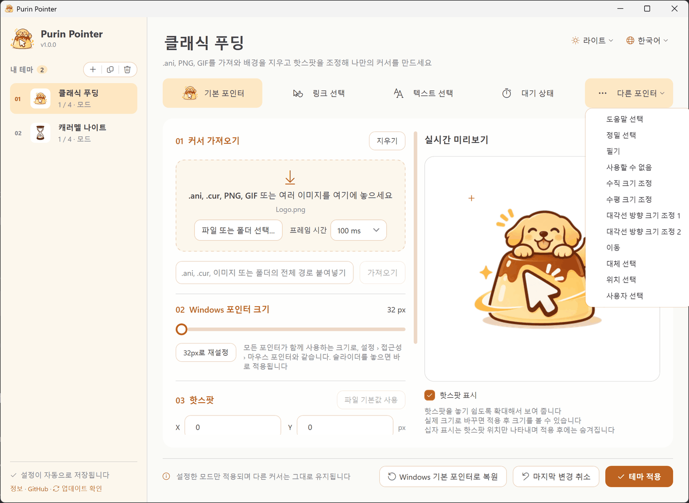
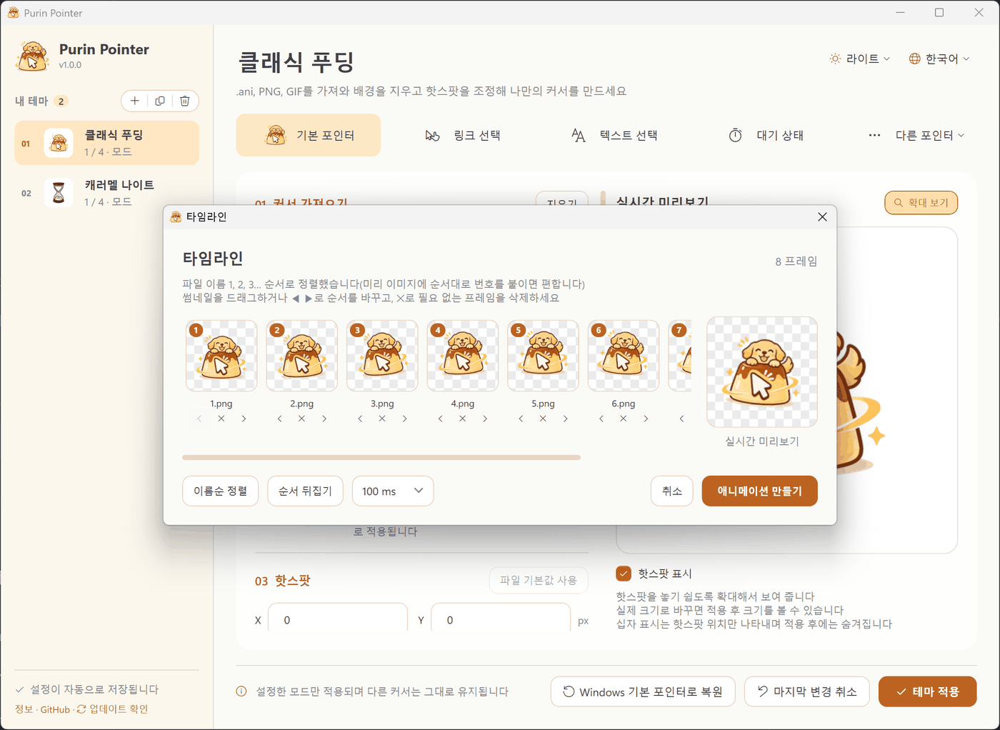
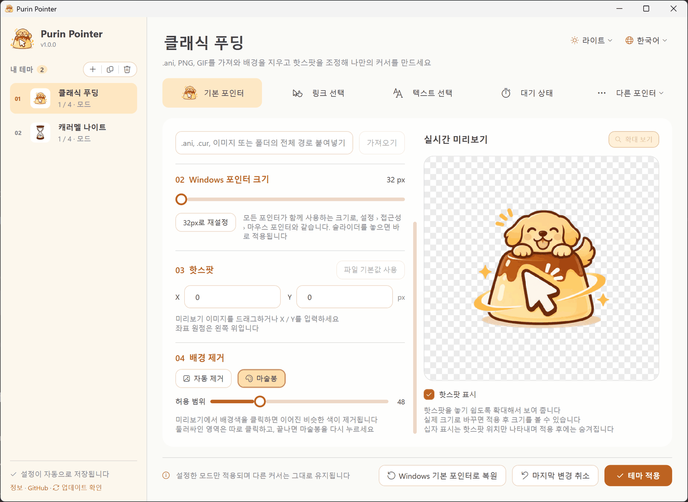
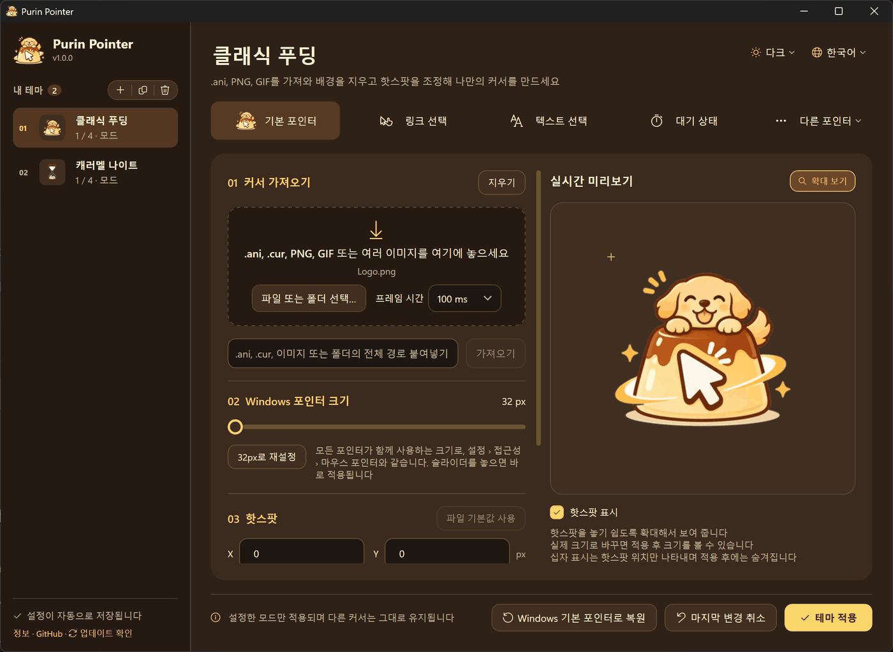

# Purin Pointer 사용자 가이드

[English](user-guide.md) · [繁體中文](user-guide.tw.md) · [日本語](user-guide.ja.md) · **한국어**

이 가이드는 처음 실행부터 문제 해결까지 Purin Pointer 1.0의 모든 부분을 다룹니다. 버튼 이름은 앱에 표시되는 그대로 **굵게** 표시합니다.

## 목차

1. [설치 및 첫 실행](#1-설치-및-첫-실행)
2. [메인 창](#2-메인-창)
3. [테마](#3-테마)
4. [모드와 포인터](#4-모드와-포인터)
5. [커서 가져오기](#5-커서-가져오기)
6. [타임라인](#6-타임라인)
7. [배경 제거](#7-배경-제거)
8. [핫스팟 설정](#8-핫스팟-설정)
9. [실시간 미리보기](#9-실시간-미리보기)
10. [Windows 포인터 크기](#10-windows-포인터-크기)
11. [테마 적용과 되돌리기](#11-테마-적용과-되돌리기)
12. [화면 모드와 언어 및 업데이트](#12-화면-모드와-언어-및-업데이트)
13. [데이터 저장 위치](#13-데이터-저장-위치)
14. [문제 해결](#14-문제-해결)

---

## 1. 설치 및 첫 실행

1. [Releases](https://github.com/Yucheng0208/Purin-Pointer/releases/latest)에서 다운로드합니다.
   - `PurinPointer-win-x64.zip`: 대부분의 Windows PC(Intel / AMD)
   - `PurinPointer-win-arm64.zip`: ARM 노트북(Snapdragon 등)
2. ZIP 파일을 원하는 곳에 압축 해제합니다. 예를 들어 문서 폴더도 좋습니다.
3. `PurinPointer.exe`를 더블클릭합니다. 설치할 것이 없으며 .NET이 내장되어 있습니다.

**Windows에 "Windows의 PC 보호"가 표시되면** **추가 정보**를 클릭한 다음 **실행**을 클릭합니다. 압축을 풀기 전에 ZIP 파일을 마우스 오른쪽 버튼으로 클릭하고 **속성**을 선택한 뒤 **차단 해제**를 체크해도 됩니다.

**Windows가 앱을 차단했다고 알리고 "실행" 버튼이 없다면** 스마트 앱 컨트롤이 켜져 있는 것입니다. 릴리스는 코드 서명되어 있지 않으므로, 이 모드에서는 Windows 11이 바로 차단합니다. 대신 소스에서 앱을 빌드하세요([엔지니어링 가이드](engineering.ko.md#build-and-run) 참고).

Purin Pointer는 관리자 권한을 요구하지 않습니다. 현재 사용자의 포인터 설정만 변경합니다.

처음 실행하면 앱이 시스템 언어로 열리고 빈 테마 하나를 만듭니다.

## 2. 메인 창

| 영역 | 기능 |
| --- | --- |
| **사이드바**(왼쪽) | 내 테마 목록입니다. 목록 위의 버튼으로 테마를 추가, 복제, 삭제합니다. |
| **테마 이름**(위쪽) | 이름을 클릭하면 테마 이름을 바꿀 수 있습니다. |
| **화면 모드**와 **언어**(오른쪽 위) | 라이트 또는 다크 화면, 그리고 인터페이스 언어입니다. |
| **모드 탭** | **기본 포인터**, **링크 선택**, **텍스트 선택**, **대기 상태**, **다른 포인터**. 각 탭은 커서가 채워지면 해당 커서를 보여 줍니다. |
| **01 커서 가져오기** | 선택한 모드에 쓸 파일을 끌어다 놓거나 선택합니다. |
| **02 Windows 포인터 크기** | Windows가 사용하는 전역 포인터 크기입니다. |
| **03 핫스팟** | 실제로 클릭되는 정확한 지점입니다. |
| **04 배경 제거** | 자동 제거와 마술봉입니다. |
| **실시간 미리보기**(오른쪽) | 적용될 모습 그대로의 커서와 핫스팟 십자 표시입니다. |
| **하단 바** | 상태 메시지, **Windows 기본 포인터로 복원**, **마지막 변경 취소**, **테마 적용**. |

왼쪽 설정 열은 따로 스크롤되므로 미리보기는 항상 화면에 보입니다.

## 3. 테마

테마는 모드마다 하나씩 지정한 커서 묶음입니다. 원하는 만큼 만들어 두고 언제든지 전환할 수 있습니다.

| 하려는 작업 | 방법 |
| --- | --- |
| 빈 테마 만들기 | 목록 위의 **+**(**새 테마**)를 클릭합니다. |
| 선택한 테마 복사 | 복사 버튼(**복제**)을 클릭합니다. |
| 선택한 테마 삭제 | 휴지통 버튼(**삭제**)을 클릭하고 확인합니다. 마지막 남은 테마는 삭제할 수 없습니다. |
| 테마 이름 바꾸기 | 창 위쪽의 이름을 클릭하고 입력합니다. |
| 테마 전환 | 사이드바에서 테마를 클릭합니다. |

각 행에는 썸네일, 이름, 4가지 주요 모드 중 몇 개가 채워졌는지가 표시됩니다(예: `1 / 4 · 모드`, 추가 포인터가 채워졌다면 `+2`도 표시).

현재 Windows에 적용된 테마에는 **사용 중** 표시가 붙습니다. 앱을 시작할 때 Windows가 실제로 그 테마의 파일을 여전히 사용하는지 확인하므로, Windows 설정에서 포인터를 바꿨다면 이 표시도 사라집니다.

모든 내용은 자동으로 저장되며, 저장 버튼은 없습니다.

## 4. 모드와 포인터

네 가지 주요 탭은 가장 자주 보는 포인터를 다룹니다.

| 탭 | 대체하는 Windows 포인터 | 기본 핫스팟 |
| --- | --- | --- |
| **기본 포인터** | 일반 선택 | 왼쪽 위 |
| **링크 선택** | 연결 선택(링크 위의 손 모양) | 왼쪽 위 |
| **텍스트 선택** | 텍스트 선택 | 가운데 |
| **대기 상태** | 사용 중 **및** 백그라운드 작업 | 가운데 |

**링크 선택**은 링크 위에 올렸을 때 표시되는 커서이며, 마우스 버튼을 누른 상태가 아닙니다. **대기 상태**는 Windows의 두 가지 대기 포인터를 한 번에 채웁니다.

나머지 12가지 Windows 포인터는 **다른 포인터**에 있습니다.

**도움말 선택**, **정밀 선택**, **필기**, **사용할 수 없음**, **수직 크기 조정**, **수평 크기 조정**, **대각선 방향 크기 조정 1**, **대각선 방향 크기 조정 2**, **이동**, **대체 선택**, **위치 선택**, **사용자 선택**. 이름 뒤의 점(●)은 이 테마에서 해당 포인터가 채워져 있다는 뜻입니다.

채워진 모드만 적용됩니다. 비워 둔 모드는 모두 Windows가 현재 사용하는 포인터를 그대로 유지합니다.

## 5. 커서 가져오기

먼저 모드 탭을 선택하세요. 가져온 커서는 그 모드에 들어갑니다.

가져오는 방법은 세 가지입니다.

- 파일 하나, 여러 파일 또는 폴더를 점선 영역에 **끌어다 놓기**.
- **파일 또는 폴더 선택…**을 클릭한 다음 **파일 선택…** 또는 **폴더 선택…**을 클릭.
- 끌어다 놓는 영역 아래 상자에 **전체 경로를 붙여넣고** **가져오기**를 클릭(또는 Enter 키). 따옴표로 묶은 경로, `file:` 링크, `%USERPROFILE%` 같은 변수도 사용할 수 있습니다.

지원하는 소스:

| 소스 | 결과 |
| --- | --- |
| `.ani` 파일 하나 | 파일 자체의 프레임, 타이밍, 핫스팟을 그대로 가져옵니다. |
| `.cur` 또는 `.ico` 파일 하나 | 파일 자체의 핫스팟을 그대로 가져옵니다. |
| PNG, JPG, BMP, TIFF 이미지 하나(Windows에 해당 코덱이 설치되어 있다면 WebP와 HEIC도 가능) | 정지 커서가 됩니다. |
| 애니메이션 GIF 하나 | GIF 자체의 타이밍을 사용하는 애니메이션 커서가 됩니다. |
| 여러 이미지 또는 이미지 폴더 | 먼저 [타임라인](#6-타임라인)이 열립니다. |

폴더 안의 이미지는 파일 탐색기와 같은 방식으로 정렬됩니다. `2.png`가 `10.png`보다 앞에 옵니다.

**프레임 시간**(50–500ms)은 여러 이미지로 애니메이션을 만들 때 각 정지 이미지를 표시하는 시간입니다.

앱은 가져온 모든 파일의 사본을 따로 보관하므로, 나중에 원본 파일을 옮기거나 삭제해도 됩니다. 큰 이미지는 최대 256px로 축소됩니다.

**지우기**(01 섹션 오른쪽 위)는 선택한 모드를 비웁니다.

## 6. 타임라인

여러 이미지를 가져오면 타임라인이 열리므로, 애니메이션을 만들기 전에 순서를 확인할 수 있습니다.

| 하려는 작업 | 방법 |
| --- | --- |
| 순서 바꾸기 | 썸네일을 드래그하거나 그 아래의 ◀ ▶를 사용합니다. |
| 프레임 삭제 | 그 아래의 ✕를 클릭합니다. |
| 파일 이름순 정렬 | **이름순 정렬**. |
| 거꾸로 재생 | **순서 뒤집기**. |
| 속도 변경 | 프레임 시간 상자에서 시간을 고릅니다. |
| 완료 | **애니메이션 만들기**. |
| 취소 | **취소**. 아무것도 가져오지 않습니다. |

오른쪽의 **실시간 미리보기**는 편집하는 동안 애니메이션을 재생합니다. 프레임이 한 화면에 다 들어가지 않으면 프레임 목록을 가로로 스크롤하세요.

팁: 가져오기 전에 파일 이름을 `1.png`, `2.png`, `3.png`…처럼 번호로 붙여 두면 처음부터 순서대로 정렬됩니다.

## 7. 배경 제거

**04 배경 제거** 섹션은 모든 프레임에 한꺼번에 적용됩니다.

- **자동 제거**는 이미지 가장자리에 닿아 있는 배경색을 지웁니다. 단색 배경의 이미지에 사용하세요.
- **마술봉**을 사용하면 미리보기에서 색을 클릭해 그 색과 이어진 비슷한 색을 함께 지울 수 있습니다. 켜져 있는 동안에는 미리보기가 체크무늬 위에 확대되어 표시되므로 투명한 부분을 확인할 수 있습니다.
  - 둘러싸인 영역(예: 글자 O의 안쪽)은 따로 클릭하세요.
  - 작업이 끝나면 **마술봉**을 다시 클릭하세요.
- **허용 범위**(8–160, 기본값 48)는 색이 얼마나 달라도 "비슷한 색"으로 볼지 정합니다. 가장자리가 남으면 값을 높이고, 너무 많이 지워지면 값을 낮추세요.
- **원본으로 복원**은 제거 작업 후에 나타나며, 가져왔을 때와 똑같은 이미지로 되돌립니다.

일치하는 색이 없으면 상태 표시줄에 그렇게 표시되고 이미지는 바뀌지 않습니다.

## 8. 핫스팟 설정

핫스팟은 실제로 클릭되는 단 하나의 픽셀입니다. 화살표의 끝, 십자선의 가운데가 그 예입니다.

- 실시간 미리보기에서 십자 표시를 원하는 위치로 **드래그**하거나,
- **X**와 **Y**를 픽셀 단위로 입력하고 Enter 키를 누릅니다. 원점(0, 0)은 이미지의 왼쪽 위 모서리이며, 미리보기의 확대 여부와 관계없이 값은 실제 포인터 픽셀 기준입니다.
- **파일 기본값 사용**은 가져온 파일에 저장된 핫스팟(이미지라면 해당 모드의 기본값)으로 되돌립니다.

미리보기 아래의 **핫스팟 표시**로 십자 표시를 켜거나 끌 수 있습니다. 십자 표시는 위치를 나타낼 뿐이며 실제 포인터에는 나타나지 않습니다.

## 9. 실시간 미리보기

미리보기는 애니메이션 커서를 실제로 동작할 모습 그대로 재생합니다.

- **확대 보기**(기본값)는 커서를 크게 보여 주므로 세부 모양과 핫스팟을 쉽게 볼 수 있습니다.
- 버튼을 클릭하면 **실제 크기 1:1**로 전환됩니다. 현재 포인터 크기에서 Windows가 사용할 크기입니다.

디스플레이 배율에 따라 실제 포인터가 1:1 미리보기보다 약간 크거나 작게 보일 수 있습니다.

## 10. Windows 포인터 크기

**02 Windows 포인터 크기**는 Windows **설정 › 접근성 › 마우스 포인터**와 같은 전역 설정이며, 두 곳은 항상 동기화됩니다.

- 슬라이더를 드래그합니다(32–256px, 16 단위). 슬라이더를 놓으면 새 크기가 적용됩니다.
- **32px로 재설정**은 Windows 기본 크기로 되돌립니다.

이 크기는 현재 테마뿐 아니라 모든 포인터와 모든 앱에 적용됩니다. Purin Pointer는 고해상도(High DPI) 화면에서도 선명하게 보이도록, 적용할 커서 파일을 포인터 크기의 두 배로 만듭니다.

## 11. 테마 적용과 되돌리기

| 버튼 | 기능 |
| --- | --- |
| **테마 적용**(Ctrl + Enter) | 선택한 테마에서 채워진 모드를 Windows에 기록합니다. 그 후 무언가를 변경할 때까지 버튼에 **테마 적용됨**이 표시됩니다. |
| **마지막 변경 취소** | Windows를 이 테마를 적용하기 전 상태로 되돌리고, 테마를 마지막 편집 전 상태로 되돌립니다. |
| **Windows 기본 포인터로 복원** | 어떤 테마가 선택되어 있든 17가지 포인터와 포인터 크기를 모두 Windows 기본값으로 되돌립니다. |

하단 바 왼쪽의 상태 메시지가 방금 일어난 일을 알려 줍니다.

적용하거나 복원할 때마다 이전 포인터 설정이 저장되므로 언제든지 되돌아갈 수 있습니다. **Windows 기본 포인터로 복원**은 덮어쓴 설정의 사본도 보관합니다([13절](#13-데이터-저장-위치) 참고).

## 12. 화면 모드와 언어 및 업데이트

- **화면 모드**(오른쪽 위): **시스템 설정에 맞춤**, **라이트** 또는 **다크**. *시스템 설정에 맞춤*은 Windows **설정 › 개인 설정 › 색**을 따르며 즉시 전환됩니다.
- **언어**(오른쪽 위): **시스템 언어** 또는 繁體中文, 简体中文, English, 日本語, 한국어. 인터페이스가 바로 전환됩니다.
- **업데이트 확인**(사이드바 아래쪽)은 현재 버전을 GitHub의 최신 릴리스와 비교하고 다운로드 페이지를 열 수 있게 해 줍니다.
- **정보**는 버전을 보여 주고, **GitHub**는 프로젝트 페이지를 엽니다.

## 13. 데이터 저장 위치

모든 데이터는 `%LOCALAPPDATA%\PurinPointer\`에 보관됩니다(파일 탐색기 주소 표시줄에 붙여넣으면 열 수 있습니다).

| 경로 | 내용 |
| --- | --- |
| `library.json` | 테마, 언어, 화면 모드, 사용 중인 테마 |
| `assets\` | 가져온 커서의 사본 |
| `cursors\` | 적용할 때 기록되는 `.cur` / `.ani` 파일. Windows는 이 파일을 가리킵니다 |
| `backups\` | 각 테마를 적용하기 전의 포인터 설정 |
| `native-reset-recovery.json` | 마지막으로 *Windows 기본 포인터로 복원*을 실행하기 전의 포인터 설정 |
| `error.log` | 예기치 않은 오류의 세부 정보(버그 보고용) |

**제거하려면**: 먼저 **Windows 기본 포인터로 복원**을 클릭하고(그렇지 않으면 Windows가 삭제될 파일을 계속 가리키게 됩니다), 앱을 닫은 다음 `PurinPointer.exe`와 위 폴더를 삭제합니다.

## 14. 문제 해결

**앱을 열면 차단됩니다.**
[1절](#1-설치-및-첫-실행)을 참고하세요. 스마트 앱 컨트롤이 켜져 있다면 소스에서 빌드하세요.

**일부 앱에서 포인터가 바뀌지 않았습니다.**
일부 앱(많은 게임, 원격 데스크톱 창)은 자체 커서를 그립니다. 마우스를 앱 밖으로 옮겼다가 다시 가져오거나 해당 앱을 다시 시작하세요. 로그아웃 후 다시 로그인하면 모든 곳에서 포인터를 다시 불러옵니다.

**포인터가 흐릿하거나 계단 현상이 보입니다.**
포인터 크기의 두 배 이상인 원본 이미지를 사용하세요(예: 32px 포인터라면 64px 이상). 아주 작은 이미지는 확대됩니다.

**배경이 너무 많이 / 너무 적게 지워졌습니다.**
**원본으로 복원**을 클릭하고 **허용 범위**를 바꾼 뒤 다시 시도하세요. 배경이 한 가지 단색이 아니라면 **마술봉**을 사용해 각 영역을 클릭하세요.

**포인터 크기가 원래대로 돌아갔습니다.**
다른 프로그램이나 Windows 설정에서 바꿨을 수 있습니다. 여기서 다시 설정하세요. 두 곳은 같은 설정을 사용합니다.

**"작업을 완료할 수 없음"이 표시됩니다.**
메시지에 원인이 표시됩니다. `error.log`가 언급되어 있다면 [GitHub Issues](https://github.com/Yucheng0208/Purin-Pointer/issues)에 문제를 보고할 때 그 파일을 첨부하세요.

**처음부터 다시 시작하고 싶습니다.**
앱을 닫고 `library.json`을 삭제하세요(모든 테마가 삭제됩니다). 다음에 실행하면 새로 만들어집니다.
