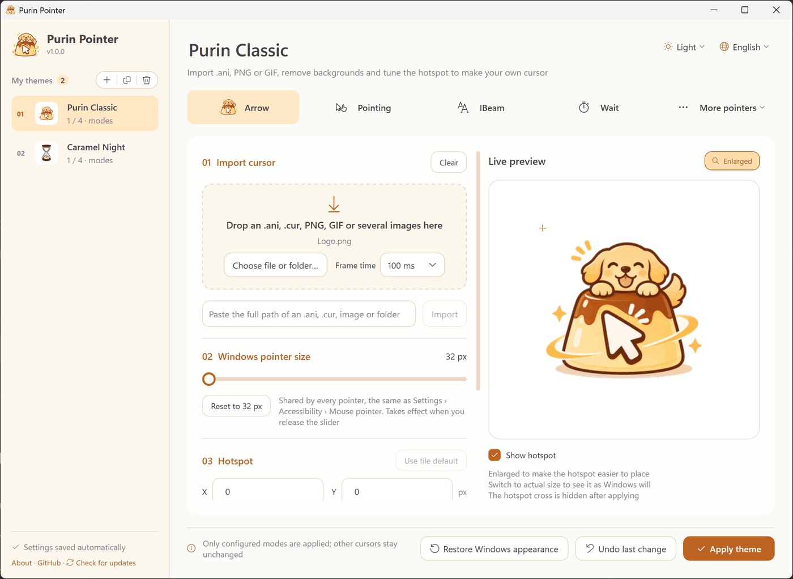
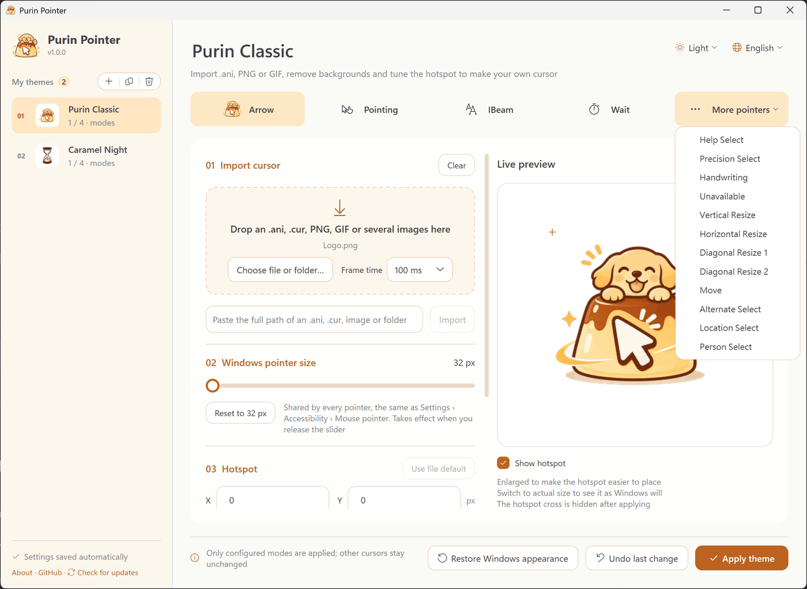
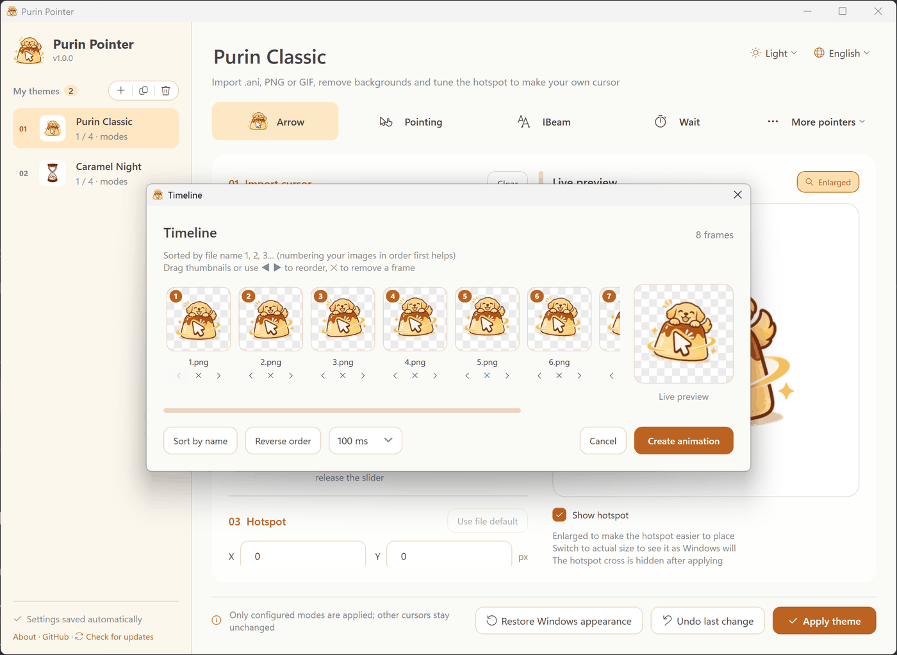
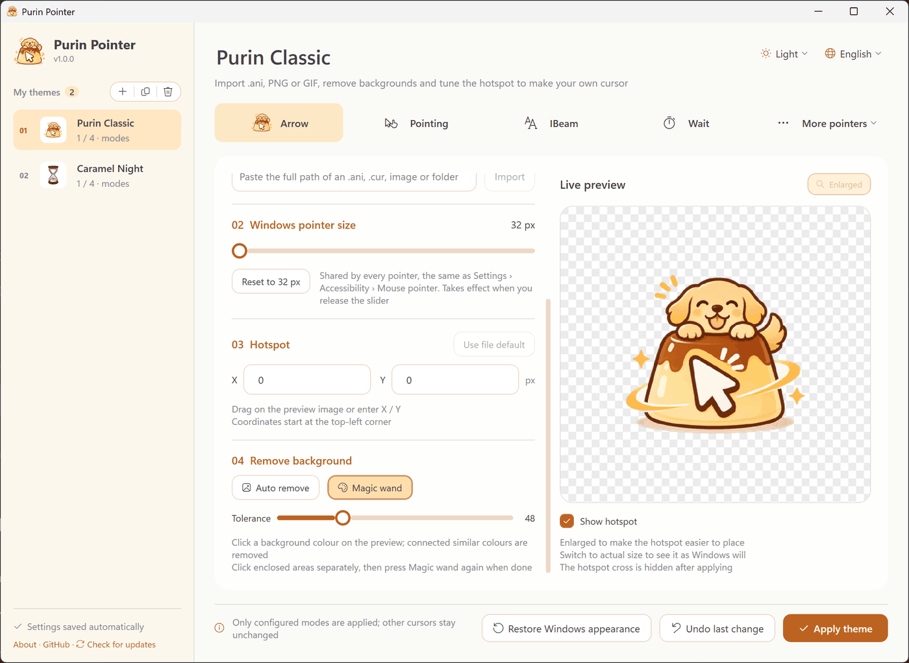
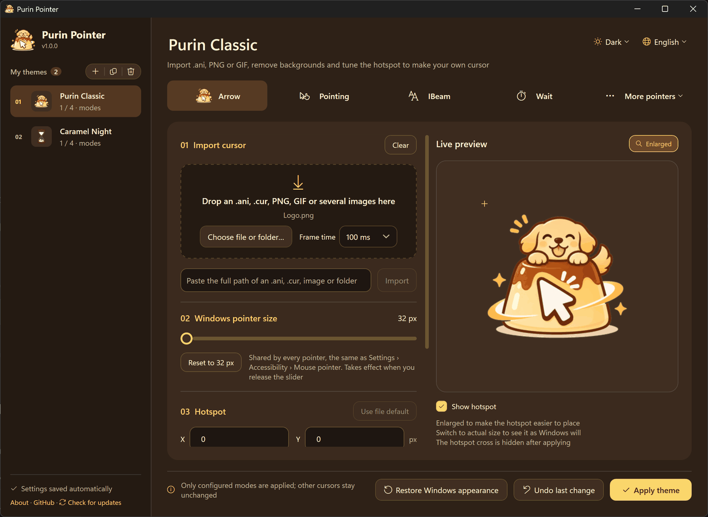

# Purin Pointer User Guide

**English** · [繁體中文](user-guide.tw.md) · [日本語](user-guide.ja.md) · [한국어](user-guide.ko.md)

This guide covers every part of Purin Pointer 1.0, from the first launch to troubleshooting. Button names appear in **bold** exactly as they are shown in the app.

## Contents

1. [Install and first launch](#1-install-and-first-launch)
2. [The main window](#2-the-main-window)
3. [Themes](#3-themes)
4. [Modes and pointers](#4-modes-and-pointers)
5. [Importing a cursor](#5-importing-a-cursor)
6. [The timeline](#6-the-timeline)
7. [Removing the background](#7-removing-the-background)
8. [Setting the hotspot](#8-setting-the-hotspot)
9. [The live preview](#9-the-live-preview)
10. [Windows pointer size](#10-windows-pointer-size)
11. [Applying, undoing and restoring](#11-applying-undoing-and-restoring)
12. [Appearance, language and updates](#12-appearance-language-and-updates)
13. [Where your data is stored](#13-where-your-data-is-stored)
14. [Troubleshooting](#14-troubleshooting)

---

## 1. Install and first launch

1. Download from [Releases](https://github.com/Yucheng0208/Purin-Pointer/releases/latest):
   - `PurinPointer-win-x64.zip` for most Windows PCs (Intel / AMD)
   - `PurinPointer-win-arm64.zip` for ARM laptops (such as Snapdragon)
2. Extract the ZIP anywhere, for example to your Documents folder.
3. Double-click `PurinPointer.exe`. There is nothing to install, and .NET is built in.

**If Windows shows "Windows protected your PC"**, click **More info**, then **Run anyway**. You can also right-click the ZIP before extracting, choose **Properties**, and tick **Unblock**.

**If Windows says the app was blocked and offers no "Run anyway"**, Smart App Control is on. Releases are not code-signed, so Windows 11 blocks them outright in that mode. Build the app from source instead (see the [engineering guide](engineering.md#build-and-run)).

Purin Pointer never asks for administrator rights. It only changes your own user's pointer settings.

On first launch, the app opens in your system language and creates one empty theme.

## 2. The main window

| Area | What it does |
| --- | --- |
| **Sidebar** (left) | Your themes. The buttons above the list add, duplicate and delete a theme. |
| **Theme name** (top) | Click the name to rename the theme. |
| **Appearance** and **Language** (top right) | Light or dark look, and the interface language. |
| **Mode tabs** | **Arrow**, **Pointing**, **IBeam**, **Wait** and **More pointers**. Each tab shows its cursor once it is filled. |
| **01 Import cursor** | Drop or choose the file for the selected mode. |
| **02 Windows pointer size** | The global pointer size Windows uses. |
| **03 Hotspot** | The exact point that clicks. |
| **04 Remove background** | Auto remove and the magic wand. |
| **Live preview** (right) | The cursor as it will look, with the hotspot cross. |
| **Footer** | Status message, **Restore Windows appearance**, **Undo last change** and **Apply theme**. |

The settings column on the left scrolls on its own, so the preview always stays in view.

## 3. Themes

A theme is a set of cursors, one per mode. You can keep as many as you like and switch between them at any time.

| To | Do this |
| --- | --- |
| Create an empty theme | Click **+** (**New theme**) above the list. |
| Copy the selected theme | Click the copy button (**Duplicate**). |
| Delete the selected theme | Click the bin button (**Delete**) and confirm. The last remaining theme cannot be deleted. |
| Rename a theme | Click its name at the top of the window and type. |
| Switch themes | Click a theme in the sidebar. |

Each row shows a thumbnail, the name, and how many of the 4 main modes are filled (for example `1 / 4 · modes`, plus `+2` if extra pointers are filled).

The theme currently applied to Windows is tagged **In use**. When the app starts, it checks that Windows really still uses that theme's files, so the tag also disappears if you changed pointers in Windows Settings.

Everything saves automatically; there is no Save button.

## 4. Modes and pointers

The four main tabs cover the pointers you see most:

| Tab | Windows pointer it replaces | Default hotspot |
| --- | --- | --- |
| **Arrow** | Normal Select | Top-left |
| **Pointing** | Link Select (the hand over links) | Top-left |
| **IBeam** | Text Select | Centre |
| **Wait** | Busy **and** Working in Background | Centre |

**Pointing** is the cursor shown while hovering a link, not a mouse-button-down state. **Wait** fills both of Windows' busy pointers at once.

The other 12 Windows pointers are under **More pointers**:

**Help Select**, **Precision Select**, **Handwriting**, **Unavailable**, **Vertical Resize**, **Horizontal Resize**, **Diagonal Resize 1**, **Diagonal Resize 2**, **Move**, **Alternate Select**, **Location Select** and **Person Select**. A dot (●) after a name means that pointer is filled in this theme.

Only filled modes are applied. Every mode you leave empty keeps whatever Windows uses now.

## 5. Importing a cursor

Select a mode tab first; the import goes into that mode.

There are three ways to import:

- **Drag and drop** a file, several files or a folder onto the dashed area.
- Click **Choose file or folder…**, then **Choose files…** or **Choose folder…**.
- **Paste a full path** into the box below the drop area and click **Import** (or press Enter). Quoted paths, `file:` links and variables such as `%USERPROFILE%` work.

Supported sources:

| Source | Result |
| --- | --- |
| One `.ani` file | Imported directly with its own frames, timing and hotspot. |
| One `.cur` or `.ico` file | Imported directly with its own hotspot. |
| One PNG, JPG, BMP or TIFF image (WebP and HEIC too, if Windows has those codecs installed) | A still cursor. |
| One animated GIF | An animated cursor with the GIF's own timing. |
| Several images, or a folder of images | Opens the [timeline](#6-the-timeline) first. |

Images in a folder are sorted like Explorer does: `2.png` comes before `10.png`.

**Frame time** (50 to 500 ms) sets how long each still image is shown when several images become an animation.

The app keeps its own copy of everything you import, so you can move or delete the original files afterwards. Large images are scaled down to at most 256 px.

**Clear** (top right of section 01) empties the selected mode.

## 6. The timeline

When you import several images, they open on the timeline so you can check the order before anything is created.

| To | Do this |
| --- | --- |
| Reorder | Drag a thumbnail, or use ◀ ▶ under it. |
| Remove a frame | Click ✕ under it. |
| Sort by file name | **Sort by name**. |
| Play backwards | **Reverse order**. |
| Change the speed | Pick a time in the frame-time box. |
| Finish | **Create animation**. |
| Cancel | **Cancel**. Nothing is imported. |

The **Live preview** on the right plays the animation as you edit it. Scroll the frame strip sideways if there are more frames than fit.

Tip: number your files `1.png`, `2.png`, `3.png`… before importing and they will already be in order.

## 7. Removing the background

Section **04 Remove background** works on every frame at once.

- **Auto remove** clears the background colour that touches the edges of the image. Use it for images on a plain background.
- **Magic wand** lets you click a colour on the preview to remove it, together with connected similar colours. While it is on, the preview is enlarged on a checkerboard so you can see what is transparent.
  - Click enclosed areas (for example the inside of a letter O) separately.
  - Click **Magic wand** again when you are done.
- **Tolerance** (8 to 160, default 48) sets how different a colour may be and still count as "similar". Raise it if edges are left behind; lower it if too much disappears.
- **Restore original** appears after a removal and brings back the image exactly as imported.

If nothing matched, the status bar says so and the image is left unchanged.

## 8. Setting the hotspot

The hotspot is the single pixel that actually clicks: the tip of an arrow, the centre of a crosshair.

- **Drag** the cross on the live preview to the right spot, or
- Type **X** and **Y** in pixels and press Enter. The origin (0, 0) is the top-left corner of the image, and the values are in real pointer pixels whether the preview is enlarged or not.
- **Use file default** goes back to the hotspot stored in the imported file (or the mode's default for images).

**Show hotspot** under the preview turns the cross on or off. The cross is only a marker; it never appears on the real pointer.

## 9. The live preview

The preview plays animated cursors exactly as they will run.

- **Enlarged** (the default) shows the cursor large, so details and the hotspot are easy to see.
- Click the button to switch to **Actual size 1:1**, the size Windows will use at the current pointer size.

Display scaling can make the real pointer look slightly larger or smaller than the 1:1 preview.

## 10. Windows pointer size

**02 Windows pointer size** is the same global setting as Windows **Settings › Accessibility › Mouse pointer**, and both stay in sync.

- Drag the slider (32 to 256 px, in steps of 16). The new size takes effect when you release it.
- **Reset to 32 px** returns to the Windows default size.

This size applies to every pointer and every app, not just the current theme. Purin Pointer builds the applied cursor files at twice the pointer size so they stay sharp on high-DPI screens.

## 11. Applying, undoing and restoring

| Button | What it does |
| --- | --- |
| **Apply theme** (Ctrl + Enter) | Writes the filled modes of the selected theme to Windows. The button then reads **Theme applied** until you change something. |
| **Undo last change** | Puts Windows back as it was before this theme was applied, and puts the theme back as it was before its last edit. |
| **Restore Windows appearance** | Puts all 17 pointers and the pointer size back to the Windows defaults, whatever theme is selected. |

The status message on the left of the footer tells you what just happened.

Your previous pointer settings are saved before every apply and every restore, so you can always get back. **Restore Windows appearance** also keeps a copy of the settings it replaced (see [section 13](#13-where-your-data-is-stored)).

## 12. Appearance, language and updates

- **Appearance** (top right): **Match system**, **Light** or **Dark**. *Match system* follows Windows **Settings › Personalisation › Colours** and switches live.
- **Language** (top right): **System language**, or 繁體中文, 简体中文, English, 日本語 or 한국어. The interface switches immediately.
- **Check for updates** (bottom of the sidebar) compares your version with the latest release on GitHub and offers to open the download page.
- **About** shows the version; **GitHub** opens the project page.

## 13. Where your data is stored

Everything is kept in `%LOCALAPPDATA%\PurinPointer\` (paste that into the Explorer address bar to open it).

| Path | Contents |
| --- | --- |
| `library.json` | Themes, language, appearance and the theme in use |
| `assets\` | Copies of imported cursors |
| `cursors\` | `.cur` / `.ani` files written when applying; Windows points here |
| `backups\` | Each theme's pointer settings from before it was applied |
| `native-reset-recovery.json` | Pointer settings from before the last *Restore Windows appearance* |
| `error.log` | Details of unexpected errors, for bug reports |

**To uninstall**: click **Restore Windows appearance** first (otherwise Windows keeps pointing at files that will be deleted), close the app, then delete `PurinPointer.exe` and the folder above.

## 14. Troubleshooting

**The app is blocked when I open it.**
See [section 1](#1-install-and-first-launch). With Smart App Control on, build from source.

**The pointer did not change in some apps.**
Some apps (many games, remote desktop windows) draw their own cursor. Move the mouse out of the app and back, or restart that app. Signing out and in reloads the pointer everywhere.

**The pointer looks blurry or jagged.**
Use a source image at least twice the pointer size (for example 64 px or more for a 32 px pointer). Very small images are scaled up.

**The background removal took too much / too little.**
Click **Restore original**, change **Tolerance**, and try again. For backgrounds that are not one flat colour, use the **Magic wand** and click each area.

**The pointer size changed back.**
Another program or Windows Settings may have changed it. Set it again here; both places use the same setting.

**"Unable to complete" appears.**
The message shows the reason. If it mentions `error.log`, include that file when reporting the problem on [GitHub Issues](https://github.com/Yucheng0208/Purin-Pointer/issues).

**I want to start over.**
Close the app and delete `library.json` (this deletes all themes). The next launch creates a fresh one.
