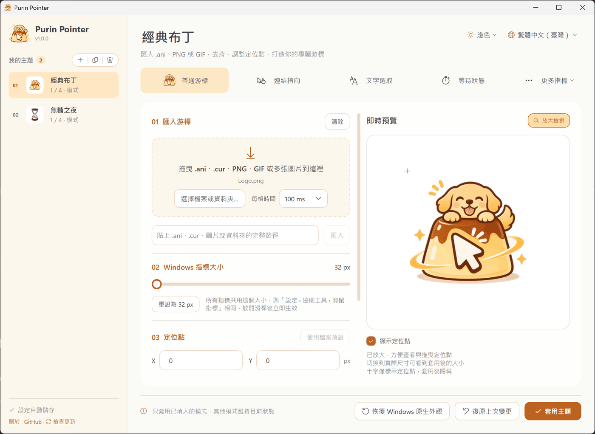
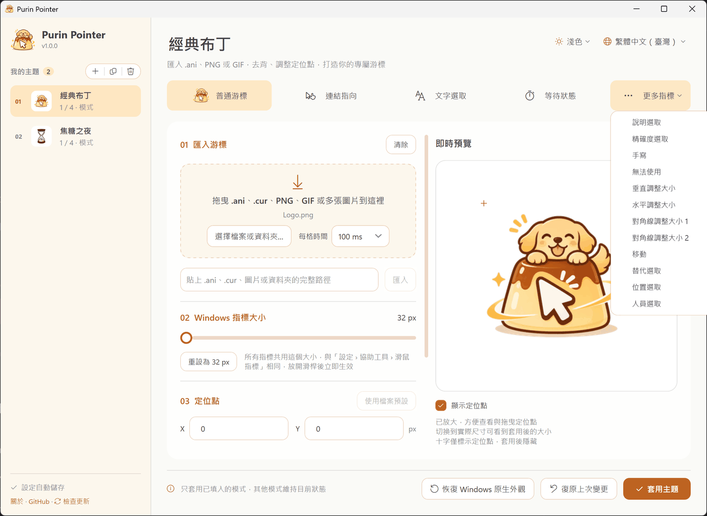
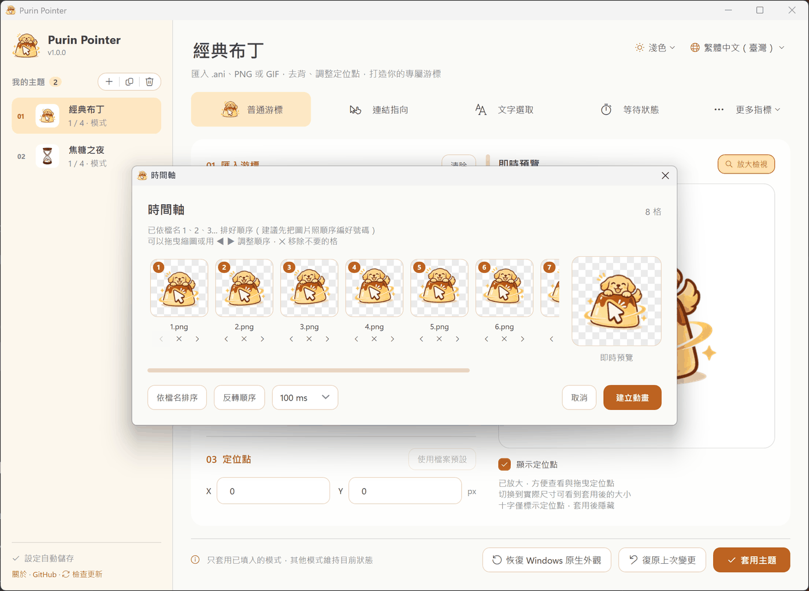
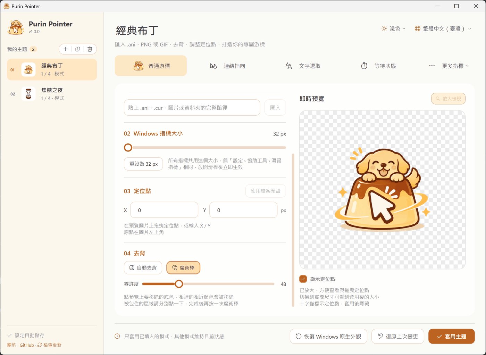
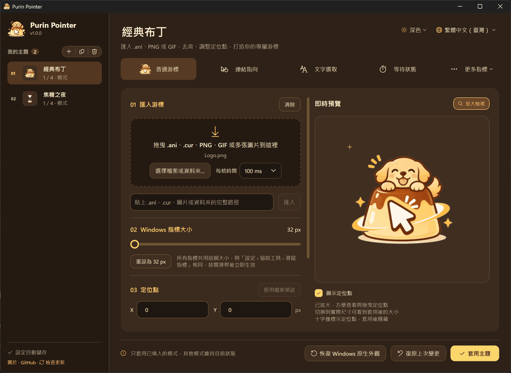

# Purin Pointer 操作手冊

[English](user-guide.md) · **繁體中文** · [日本語](user-guide.ja.md) · [한국어](user-guide.ko.md)

本手冊涵蓋 Purin Pointer 1.0 的所有功能，從第一次開啟到疑難排解。文中以**粗體**標示的按鈕名稱，都和程式畫面上的文字完全相同。

## 目錄

1. [安裝與首次啟動](#1-安裝與首次啟動)
2. [主視窗](#2-主視窗)
3. [主題](#3-主題)
4. [模式與指標](#4-模式與指標)
5. [匯入游標](#5-匯入游標)
6. [時間軸](#6-時間軸)
7. [去背](#7-去背)
8. [設定定位點](#8-設定定位點)
9. [即時預覽](#9-即時預覽)
10. [Windows 指標大小](#10-windows-指標大小)
11. [套用復原與恢復](#11-套用復原與恢復)
12. [外觀語言與更新](#12-外觀語言與更新)
13. [資料存放位置](#13-資料存放位置)
14. [疑難排解](#14-疑難排解)

---

## 1. 安裝與首次啟動

1. 到 [Releases](https://github.com/Yucheng0208/Purin-Pointer/releases/latest) 下載：
   - `PurinPointer-win-x64.zip`：大多數 Windows 電腦（Intel／AMD）
   - `PurinPointer-win-arm64.zip`：ARM 筆電（例如 Snapdragon）
2. 把 ZIP 解壓縮到任何地方，例如「文件」資料夾。
3. 按兩下 `PurinPointer.exe`。不需要安裝，.NET 也已經內建。

**如果 Windows 顯示「Windows 已保護您的電腦」**，請按「**其他資訊**」，再按「**仍要執行**」。也可以在解壓縮前，對 ZIP 按右鍵 →「**內容**」→ 勾選「**解除封鎖**」。

**如果 Windows 說程式已被封鎖，而且沒有「仍要執行」可以按**，代表「智慧型應用程式控制」是開啟的。發佈版本沒有程式碼簽章，在這個模式下會被 Windows 11 直接封鎖。這時請改從原始碼建置（見[工程說明](engineering.tw.md#build-and-run)）。

Purin Pointer 從不要求系統管理員權限，只會修改你自己這個使用者的指標設定。

第一次開啟時，程式會使用系統語言，並建立一個空白主題。

## 2. 主視窗

| 區域 | 用途 |
| --- | --- |
| **側欄**（左） | 你的主題。清單上方的按鈕可以新增、複製、刪除主題。 |
| **主題名稱**（上方） | 點一下名稱就能重新命名。 |
| **外觀**與**語言**（右上） | 淺色或深色外觀，以及介面語言。 |
| **模式分頁** | 「**普通游標**」、「**連結指向**」、「**文字選取**」、「**等待狀態**」與「**更多指標**」。填入游標後，分頁上會顯示它的樣子。 |
| **01 匯入游標** | 為目前的模式拖曳或選擇檔案。 |
| **02 Windows 指標大小** | Windows 使用的全域指標大小。 |
| **03 定位點** | 實際點擊的那一點。 |
| **04 去背** | 自動去背與魔術棒。 |
| **即時預覽**（右） | 游標實際的樣子，附定位點十字。 |
| **底部列** | 狀態訊息、「**恢復 Windows 原生外觀**」、「**復原上次變更**」與「**套用主題**」。 |

左側的設定欄會單獨捲動，右側的預覽一直保持可見。

## 3. 主題

主題是一組游標，每個模式各一個。你可以保留任意數量的主題，隨時切換。

| 想要 | 操作 |
| --- | --- |
| 建立空白主題 | 按清單上方的 **+**（「**新增主題**」）。 |
| 複製目前的主題 | 按複製按鈕（「**複製主題**」）。 |
| 刪除目前的主題 | 按垃圾桶按鈕（「**刪除**」）並確認。最後一個主題無法刪除。 |
| 重新命名 | 點視窗上方的主題名稱，直接輸入。 |
| 切換主題 | 在側欄點選主題。 |

每一列會顯示縮圖、名稱，以及 4 個主要模式填了幾個（例如 `1 / 4 · 模式`；填了額外指標會再顯示 `+2` 這類數字）。

目前套用到 Windows 的主題會標示「**使用中**」。程式啟動時會確認 Windows 是否真的還在使用這個主題的檔案，所以如果你在 Windows 設定裡改過指標，這個標籤也會自動消失。

所有變更都會自動儲存，沒有「儲存」按鈕。

## 4. 模式與指標

四個主要分頁涵蓋最常看到的指標：

| 分頁 | 取代的 Windows 指標 | 預設定位點 |
| --- | --- | --- |
| **普通游標** | 一般選取 | 左上角 |
| **連結指向** | 連結選取（滑過連結時的手指） | 左上角 |
| **文字選取** | 文字選取 | 中心 |
| **等待狀態** | 忙碌**以及**在背景作業 | 中心 |

「**連結指向**」是滑過連結時的手指，不是按住按鍵的狀態。「**等待狀態**」會同時套用到 Windows 的兩種忙碌指標。

其餘 12 種 Windows 指標在「**更多指標**」裡：

「**說明選取**」、「**精確度選取**」、「**手寫**」、「**無法使用**」、「**垂直調整大小**」、「**水平調整大小**」、「**對角線調整大小 1**」、「**對角線調整大小 2**」、「**移動**」、「**替代選取**」、「**位置選取**」與「**人員選取**」。名稱後面有圓點（●）表示這個主題已經填了該指標。

只有填入的模式會被套用。留空的模式會維持 Windows 目前的樣子。

## 5. 匯入游標

先選好模式分頁，匯入的游標就會放進那個模式。

匯入有三種方式：

- 把檔案、多個檔案或資料夾**拖曳**到虛線框裡。
- 按「**選擇檔案或資料夾…**」，再選「**選擇檔案…**」或「**選擇資料夾…**」。
- 在虛線框下方的欄位**貼上完整路徑**，按「**匯入**」（或按 Enter）。可以貼上帶引號的路徑、`file:` 連結，或 `%USERPROFILE%` 這類環境變數。

支援的素材：

| 素材 | 結果 |
| --- | --- |
| 一個 `.ani` 檔 | 直接匯入，保留原本的畫格、時間與定位點。 |
| 一個 `.cur` 或 `.ico` 檔 | 直接匯入，保留原本的定位點。 |
| 一張 PNG、JPG、BMP 或 TIFF 圖片（Windows 有安裝對應解碼器時，WebP 與 HEIC 也可以） | 靜態游標。 |
| 一張動態 GIF | 動態游標，使用 GIF 本身的時間。 |
| 多張圖片或整個圖片資料夾 | 先開啟[時間軸](#6-時間軸)。 |

資料夾裡的圖片會依照檔案總管的方式排序：`2.png` 排在 `10.png` 前面。

「**每格時間**」（50 到 500 ms）決定多張靜態圖片組成動畫時，每一格顯示多久。

程式會保留一份自己的副本，所以匯入後可以移動或刪除原始檔案。過大的圖片會縮小到最多 256 px。

「**清除**」（01 區塊右上角）會清空目前的模式。

## 6. 時間軸

匯入多張圖片時，會先開啟時間軸讓你確認順序，確定後才會建立游標。

| 想要 | 操作 |
| --- | --- |
| 調整順序 | 拖曳縮圖，或使用縮圖下方的 ◀ ▶。 |
| 刪除畫格 | 按縮圖下方的 ✕。 |
| 依檔名排序 | 「**依檔名排序**」。 |
| 倒著播放 | 「**反轉順序**」。 |
| 調整速度 | 在每格時間選單選一個時間。 |
| 完成 | 「**建立動畫**」。 |
| 取消 | 「**取消**」。不會匯入任何東西。 |

右側的「**即時預覽**」會隨著你的編輯播放動畫。畫格太多放不下時，可以左右捲動畫格列。

小技巧：匯入前先把檔案命名為 `1.png`、`2.png`、`3.png`…，順序就會自動排好。

## 7. 去背

「**04 去背**」會一次處理所有畫格。

- 「**自動去背**」會清除碰到圖片邊緣的背景色，適合單色背景的圖片。
- 「**魔術棒**」：在預覽上點一個顏色，就會移除它和相連的相近顏色。開啟時，預覽會放大並顯示在棋盤格上，方便看出哪些地方已經透明。
  - 被包圍的區域（例如字母 O 的內側）需要分開點。
  - 完成後再按一次「**魔術棒**」。
- 「**容許度**」（8 到 160，預設 48）決定顏色差多少以內算「相近」。邊緣有殘留就調高，去掉太多就調低。
- 「**還原原圖**」會在去背後出現，可以把圖片恢復成剛匯入時的樣子。

如果沒有任何顏色符合，狀態列會告訴你，圖片也不會改變。

## 8. 設定定位點

定位點是實際負責點擊的那一個像素，例如箭頭的尖端、十字的中心。

- 在即時預覽上**拖曳**十字到正確的位置，或
- 輸入 **X** 和 **Y**（單位是像素）後按 Enter。原點 (0, 0) 在圖片左上角。不論預覽是否放大，數值都是游標實際的像素。
- 「**使用檔案預設**」會回到匯入檔案裡記錄的定位點（圖片則回到該模式的預設值）。

預覽下方的「**顯示定位點**」可以開關十字。十字只是標記，不會出現在真正的游標上。

## 9. 即時預覽

預覽會照游標實際的速度播放動畫。

- 「**放大檢視**」（預設）把游標放大顯示，方便看清細節與定位點。
- 按一下這個按鈕可以切換到「**實際尺寸 1:1**」，也就是目前指標大小下 Windows 顯示的大小。

顯示器縮放可能會讓實際的游標比 1:1 預覽稍大或稍小。

## 10. Windows 指標大小

「**02 Windows 指標大小**」和 Windows「**設定 › 協助工具 › 滑鼠指標**」是同一個全域設定，兩邊會保持同步。

- 拖曳滑桿（32 到 256 px，每格 16）。放開滑桿後立即生效。
- 「**重設為 32 px**」會回到 Windows 預設大小。

這個大小會套用到所有指標和所有程式，不只是目前的主題。Purin Pointer 會以指標大小的兩倍產生套用用的游標檔，在高 DPI 螢幕上也能保持清晰。

## 11. 套用復原與恢復

| 按鈕 | 作用 |
| --- | --- |
| 「**套用主題**」（Ctrl + Enter） | 把目前主題已填入的模式寫入 Windows。之後按鈕會顯示「**已套用主題**」，直到你做了新的修改。 |
| 「**復原上次變更**」 | 讓 Windows 回到套用這個主題之前的樣子，並讓主題回到上一次編輯之前的狀態。 |
| 「**恢復 Windows 原生外觀**」 | 不論選了哪個主題，都把 17 種指標與指標大小改回 Windows 預設。 |

底部列左側的狀態訊息會告訴你剛剛發生了什麼事。

每次套用和恢復之前，程式都會先備份原本的指標設定，所以隨時都能回去。「**恢復 Windows 原生外觀**」也會保留一份被取代的設定（見[第 13 節](#13-資料存放位置)）。

## 12. 外觀語言與更新

- **外觀**（右上）：「**跟隨系統**」、「**淺色**」或「**深色**」。「跟隨系統」會依照 Windows「**設定 › 個人化 › 色彩**」即時切換。
- **語言**（右上）：「**跟隨系統語言**」，或選擇繁體中文、简体中文、English、日本語、한국어。介面會立即切換。
- 「**檢查更新**」（側欄下方）會比對你的版本與 GitHub 上的最新版本，並提供開啟下載頁面的選項。
- 「**關於**」顯示版本資訊；「**GitHub**」開啟專案頁面。

## 13. 資料存放位置

所有資料都存放在 `%LOCALAPPDATA%\PurinPointer\`（貼到檔案總管的網址列就能開啟）。

| 路徑 | 內容 |
| --- | --- |
| `library.json` | 主題、語言、外觀與使用中的主題 |
| `assets\` | 匯入游標的副本 |
| `cursors\` | 套用時產生的 `.cur`／`.ani` 檔，Windows 會指向這裡 |
| `backups\` | 每個主題套用前的指標設定 |
| `native-reset-recovery.json` | 上次「恢復 Windows 原生外觀」之前的指標設定 |
| `error.log` | 非預期錯誤的詳細資訊，回報問題時使用 |

**移除程式**：先按「**恢復 Windows 原生外觀**」（否則 Windows 會一直指向即將被刪除的檔案），關閉程式，再刪除 `PurinPointer.exe` 和上面的資料夾。

## 14. 疑難排解

**開啟時程式被封鎖。**
請看[第 1 節](#1-安裝與首次啟動)。開啟「智慧型應用程式控制」時，請從原始碼建置。

**有些程式裡游標沒有改變。**
有些程式（許多遊戲、遠端桌面視窗）會自己繪製游標。把滑鼠移出再移回那個程式，或重新啟動它。登出再登入可以讓所有地方重新載入指標。

**游標看起來模糊或有鋸齒。**
請使用至少是指標大小兩倍的圖片（例如 32 px 的指標用 64 px 以上的圖片）。太小的圖片會被放大。

**去背去掉太多或太少。**
按「**還原原圖**」，調整「**容許度**」後再試一次。如果背景不是單一顏色，請用「**魔術棒**」逐一點選各個區域。

**指標大小又變回去了。**
可能是其他程式或 Windows 設定改了它。在這裡重新設定即可，兩邊用的是同一個設定。

**出現「無法完成操作」。**
訊息裡會說明原因。如果提到 `error.log`，回報問題到 [GitHub Issues](https://github.com/Yucheng0208/Purin-Pointer/issues) 時請附上這個檔案。

**想要全部重來。**
關閉程式並刪除 `library.json`（所有主題都會被刪除）。下次開啟時會建立一份新的。
